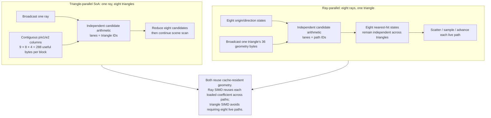
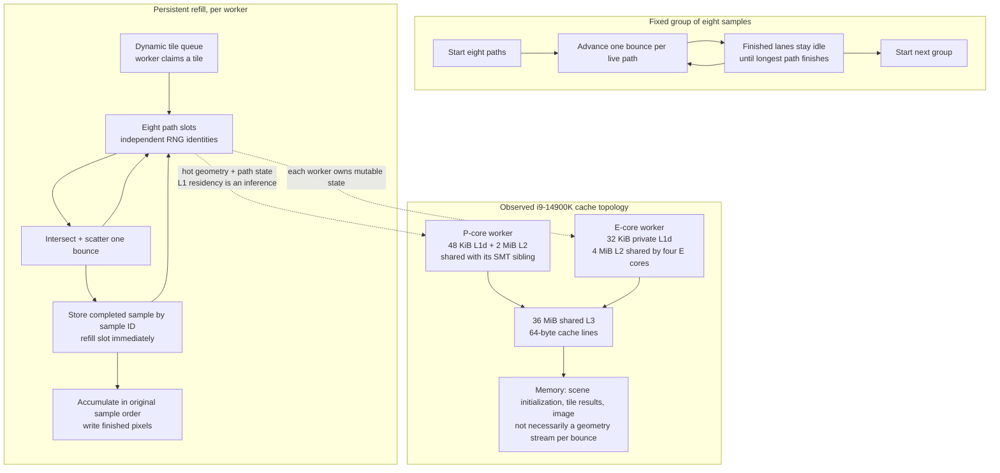

# Astra computation and dataflow pass

The strongest result so far is that independent, continuously replenished paths matter more than explicit intrinsics. On the root agent's exploratory 128×128, 64 spp render, ordinary C++ ray SIMD with an eight-path refill queue took 0.3064 s. A focused change to the explicit AVX2 Möller kernel reduced its own three-run median from 0.4451 s to 0.3325 s while preserving every output bit. Explicit affine rays previously took 0.4426 s. These are render-only exploratory timings from separate sweeps, not the final 320×320 benchmark. The three aggressive implementations below are useful experiments; none should be described as an end-to-end winner before the full renderer results are included. The root's final ranking uses complete process wall time and retains render-only rates separately.

## What moves and what waits

Each original triangle occupies 72 bytes: `p`, `e1`, `e2`, normal, albedo, and emission. Intersection needs the first 36 bytes; shading needs the selected triangle's other attributes. All 36 original triangles occupy 2,592 bytes. Flat geometry adds 1,296 bytes of useful coordinate data; its three candidate arrays occupy 432 bytes. These are unique working-set sizes, not DRAM bytes transferred on every query.

A fully evaluated Möller candidate performs two cross products and four dot products, plus offset subtraction, reciprocal scaling, and validity tests: 27 multiplies and 18 additions/subtractions including `u+v`, plus one division. That 45-operation count describes source arithmetic before FMA contraction. Scalar early rejection often avoids later work. A division and the dependent nearest-hit update can limit progress even when all geometry is cached. FMA combines arithmetic instructions and changes rounding; it is not an additional SIMD width.

The scene and active ray state are small enough for L1 data cache. Linux sysfs was read again during this pass: CPU 8 and sibling 9 share 48 KiB L1d and 2 MiB L2; CPU 16 has 32 KiB private L1d and shares 4 MiB L2 with CPUs 16–19; all CPUs share 36 MiB L3; cache lines are 64 bytes. The topology is observed. Actual L1 residency, spill cost, branch cost, divider pressure, and instruction bottlenecks remain inferences because hardware performance counters are unavailable. A render's output and refill result buffer also occupy cache space; small geometry alone does not prove every access hits L1.

The useful objective is completed equivalent paths per second. Counting more FLOPs per byte can reward unnecessary arithmetic. A bounds test that avoids twenty triangle candidates can lower arithmetic intensity while improving the renderer. Conversely, eliminating divisions can lose if additional dependent branches serialize execution.

```mermaid
flowchart LR
  R["Ray: origin + direction<br/>24 B of state"] --> H["h = direction × e2<br/>cross product 1"]
  G["AoS triangle: 72 B stride<br/>p/e1/e2: 36 useful geometry bytes"] --> H
  H --> D["det = e1 · h<br/>dot product 1 / front-face test"]
  D --> I["inverse = 1 / det"]
  G --> S["s = origin − p"]
  R --> S
  S --> U["u numerator = s · h<br/>dot product 2"]
  H --> U
  I --> U
  U --> UT["u range test<br/>scalar early exit"]
  S --> Q["q = s × e1<br/>cross product 2"]
  UT --> Q
  Q --> V["v numerator = direction · q<br/>dot product 3 / v and u+v tests"]
  V --> T["t numerator = e2 · q<br/>dot product 4 / t threshold"]
  T --> N["Nearest-hit update<br/>dependent across triangles"]
  N --> SH["Selected normal, albedo, emission<br/>path weight + radiance"]
  SH --> RNG["Random values → sqrt / sin / cos<br/>uniform sphere sample reflected into hemisphere"]
  RNG --> NEXT["Next ray and throughput<br/>next bounce depends on this hit"]
  NEXT --> R
```

The inverse scales the u/v/t numerators; the drawing compresses those three multiplies. Across bounces, a single path is serial: the next direction and origin depend on the current hit. Across paths, those dependencies are independent.

## Three aggressive proposals implemented

### 1. Precompute triangle plane and barycentric transforms

`aggressive::AffineScene<SceneData>` precomputes an unnormalized plane normal and two dual barycentric vectors. Per query it computes the plane intersection, then evaluates two linear barycentric forms at the relative hit point. This removes both per-ray cross products. Preparation uses double precision; tracing uses AVX2 FMA and exact division. Five eight-triangle coefficient blocks occupy 2,240 bytes including IDs, parallel thresholds, and padded tails. Original triangles remain available for shading.

The tradeoff is more coefficient bytes and register operands in exchange for less repeated arithmetic. It has moderate implementation complexity and is appropriate for a static scene reused by many rays. Geometry edits require preparation again. It changes floating-point evaluation order, so seeded historical bitwise image parity is not promised.

On the fixed corpus it took 9.498837 ms, versus 35.479620 ms for scalar FMA intersection. The exploratory full renderer was 0.4001 s, only modestly faster than flat triangle SIMD at 0.4186 s. These two comparisons measure different scopes. Removing cross products does not remove RNG, trigonometry, scattering, path dependencies, or scheduling.

### 2. Reject small triangle groups before doing triangle arithmetic

`aggressive::CulledScene<SceneData>` builds centroid splits minimizing the sum of each child surface area times its triangle count, stopping at eight triangles. The Cornell scene produces six leaves. Runtime traversal tests six leaf AABBs together, then intersects only surviving leaves with explicit AVX2 Möller. This is a shallow, flattened group accelerator, not a general deep BVH traversal. Bounds are padded conservatively for this scene's finite coordinate scale; zero direction components have explicit slab handling.

One group allocation is 3,040 bytes including bounds, padded triangle blocks, IDs, parallel thresholds, and alignment. The software-counted corpus performed 3,617,268 triangle candidates and 1,572,864 leaf-bound tests over 262,144 queries: 13.80 triangle candidates and six box tests per ray, versus about 36 candidates for the other approaches. That is a 61.7% reduction in triangle candidates. It was the fastest advanced fixed-ray implementation at 8.831520 ms, but its exploratory full render was 0.4142 s. Branching and bounds overhead can offset skipped work on a 36-triangle scene; larger or more spatially separated scenes are a different experiment.

This has the most scene-building code. It changes evaluation order and floating-point arithmetic; ties use the original triangle ID. The implementation follows the general surface-area cost principle described in [PBRT's BVH chapter](https://pbr-book.org/4ed/Primitives_and_Intersection_Acceleration/Bounding_Volume_Hierarchies), with its own small-scene representation.

### 3. Reuse each triangle across eight independent, replenished rays

`aggressive::Ray8Scene<SceneData>` broadcasts one triangle into eight ray lanes, maintains nearest hits per ray, and scatters results once after the scene scan. `Ray8AffineScene` tests the same organization with precomputed transforms. Both expose `intersect_batch(const Ray*, Hit*, int, Scratch&)`, accept tails, and ignore zero-direction inactive lanes. The root renderer supplies a persistent refill queue and preserves per-path RNG identity and ordered pixel accumulation.

The geometry reuse is concrete: a group of eight rays can consume each 36-byte triangle's useful coordinates once, rather than once per ray. For 36 triangles this is 1,296 useful geometry bytes per group, or 162 per ray, excluding threshold data, cache-line fetches, state transport, and register spills. These numbers are neither L1 traffic measurements nor DRAM bandwidth measurements. Keeping eight paths alive also provides independent work through the hit/shading/bounce cycle; the ordinary C++ version already obtains this benefit.

The initial explicit Möller ray kernel took 11.792205 ms on the fixed corpus; affine rays took 10.844033 ms. Its staged masks avoid many divisions, but generated code has four `vmovmskps` / integer-test / conditional-branch stages before the Möller divide. The ordinary C++ kernel issues the divide immediately after the determinant and then computes independent numerator arithmetic. The explicit kernel also maintains a near-parallel detection vector and direction norm, adding live state. Disassembly shows stack traffic in both kernels, so source-level SIMD does not guarantee register residency.

The promoted Ray8 implementation now starts division immediately after the determinant, removes those four rejection branches, and retains exactly the original determinant-scaled validity masks, final rounded-distance comparison, FMA expressions, and near-parallel fallback. Five interleaved repetitions using eight-ray calls measured median times of 12.053874 ms staged, 6.631909 ms branchless, and 6.595712 ms ordinary C++. These are a separate comparison from the earlier all-corpus batch benchmark. The branchless change cuts explicit intersection time by about 45%; differences between branchless and C++ are small relative to the short-run variation.

In a matched 128×128, 64 spp refill render, one warm-up followed by three alternating repetitions gave 0.445102317 s staged and 0.332503030 s branchless, a 25.3% render-time reduction. Both produced exactly 7,116,559 ray segments and identical float32 pixel files, SHA-256 `1a7852645eec578ee6a4afee236892b6482ba7d74f9aa3ebb466b076d1b65cf6`. Every hit bit also matched across the 262,144 fixed rays. This intervention demonstrates that the combination of earlier division and branch removal is useful here; it does not separately quantify branch misprediction, divider stalls, or spill costs. The ordinary C++ refill implementation remains faster in the exploratory complete-render comparison.

## Numerical validation and reproducibility

All four advanced backends have zero hit-ID mismatches against an independent double Möller reference on the 262,144-ray corpus. Maximum relative distance errors are 6.70e-6 for affine and 1.38e-5 for Möller; maximum absolute barycentric error is approximately 2.11e-6. The corpus mixes outside rays, camera rays, surface-origin diffuse rays, and random interior rays. Its binary SHA-256 is `f0694fa864d42deec87fd54a7c5e3ecc49a1077b74725330d81af7163375b942`.

Each backend also runs 58,790 stress cases covering zero/1/7/8/9/17/36 triangles, parallel and backface rays, edges and vertices, duplicate-triangle ties, t-threshold cases, and vector tails. A rare near-parallel query triggers a complete double-precision reference-style scan. On the broad corpus this happened four times for affine and ray backends, twice for culling. The stress suite has zero unexplained discrepancies, but allows explicitly classified boundary choices: one affine, two culled, zero ray-Möller, and one ray-affine hit-ID differences against double. These kernels are not proven watertight; the [Woop, Benthin, and Wald paper](https://jcgt.org/published/0002/01/05/paper.pdf) addresses the stronger shared-edge guarantee. Sanitizers also passed the combined suite.

The initial fixed-ray timings use one warm-up and five consecutive repeats per backend, GCC 15.2, `-O3 -march=native -ffp-contract=fast -std=c++17`, pinned to P-core CPU 8. The later focused branchless comparison alternates the three backends. Validation and checksum work are outside timed intersection. The corpus is resident and this is a microbenchmark, not a path-tracing speedup claim. Raw times, source hashes, work counts, binary corpus, and sanitizer output remain under remote `build/astra-pass2/`. The final root benchmark should supersede exploratory renderer values. The promoted header SHA-256 is `2719144a19697eb6188325255dd9f8bdc0dff71627ab6431fbb6341c9a82254d`; `sanitizer-validation-final.txt` records a passing combined suite with ASan and UBSan after the branchless change.

The **initial staged** software counts were 1,310,706 vector divisions for affine, 206,014 culled, 182,560 ray-Möller, and 888,770 ray-affine. They count issued eight-wide instructions, excluding scalar fallback divisions. They must not be attributed to the promoted branchless ray kernel. The final branchless loop issues one vector division per triangle per group: exactly `36 × (262,144 / 8) = 1,179,648` for this full-width fixed corpus, derived directly from its straight-line loop rather than a new counter run. It therefore issues substantially more divisions while running faster. Useful scheduling and dependency overlap matter more than one operation count. Triangle candidate counts and fallback behavior are unchanged by this bit-preserving loop transformation.

## Scheduling and cache flow

The observed fixed-group live-slot ratio around 42% explains why refill deserves measurement before more SIMD machinery. Work stealing through tile claims accommodates P/E speed differences without predicting equal work per core. SMT may help hide dependencies or compete for the same execution and cache resources; only the full measured worker-count matrix can choose it. The queues do not change Monte Carlo sampling when path identity and accumulation order are retained. Tile result buffers trade additional cache traffic for deterministic summation. A smaller ordered completion ring or direct SoA state interface can be future experiments; neither is required to explain the present winner.

For architectural context, Intel's [i9-14900K specification](https://www.intel.com/content/www/us/en/products/sku/236773/intel-core-i9-processor-14900k-36m-cache-up-to-6-00-ghz/specifications.html) lists 8 P cores, 16 E cores, 32 threads, 32 MiB total L2, and 36 MiB cache. [uops.info VDIVPS measurements](https://www.uops.info/html-instr/VDIVPS_YMM_YMM_YMM.html) and Intel's [Gracemont optimization document](https://cdrdv2.intel.com/v1/dl/getContent/723461) show why division throughput can differ materially between core types. Those sources provide architectural context; they are not measured cycle counts for this program on this 14900K.
