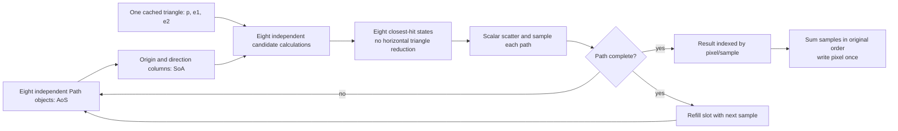
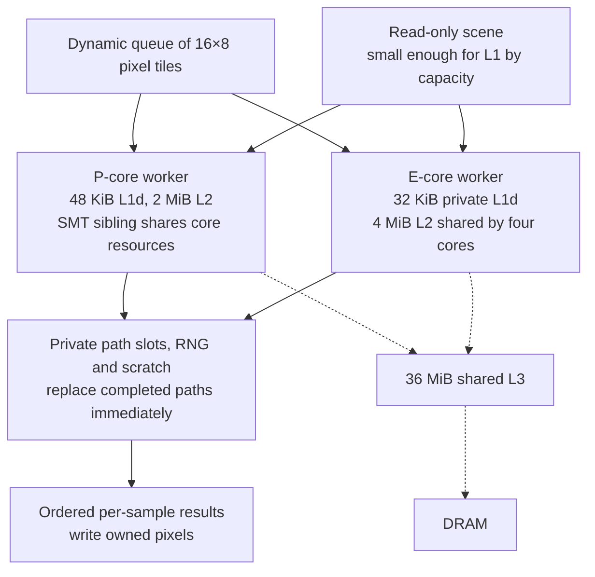

# Optimizing the computation

This pass implements three simple proposals and three aggressive proposals on blacknoir's i9-14900K. The score is **completed paths per second**, measured over the whole executable including startup, scene preparation, rendering and HDR writing. Render-only time is retained as a supporting measurement. A completed path includes a miss, an emissive hit, or termination at the existing 24-visit limit; it does not necessarily reach a light.

The computation is unchanged at the estimator level: the same 36-triangle Cornell scene, camera jitter, front-face triangle convention, uniform hemisphere sampler, Lambertian `2*cosine` weight, and termination rules. All new backends receive identical random streams indexed by pixel/sample, and accumulate samples in the same order. No light sampling, Russian roulette, reduced sample count, approximate reciprocal, or approximate trigonometry is introduced.

## Results

The main workload is 320×320 at 128 spp: **13,107,200 completed paths**. GCC 15.2.0 uses `-O3 -march=native -ffp-contract=fast -std=c++17 -pthread`. One full warmup per configuration precedes five interleaved measured runs. One-worker configurations are pinned to P-core CPU 8; 32-worker configurations use CPUs 0–31. These are observed medians and ranges on a shared workstation, not confidence intervals.

| Configuration | Wall median | Wall range | Million paths/s | Render median |
| --- | ---: | ---: | ---: | ---: |
| Matched scalar, 1 P core | 13.2185 s | 13.1446–13.2298 s | 991577.55 | 13.2158 s |
| S1 flat SoA, 1 P core | 6.1432 s | 6.1002–6.1796 s | 2133610.19 | 6.1405 s |
| C++ eight-ray fixed groups, 1 P core | 7.3745 s | 7.3684–7.4061 s | 1777357.29 | 7.3715 s |
| S3 C++ eight-ray refill, 1 P core | 3.8562 s | 3.8315–3.9232 s | 3398955.61 | 3.8533 s |
| Matched scalar, contraction off | 13.3862 s | 13.2807–13.3939 s | 979156.81 | 13.3830 s |
| S3 C++ refill, contraction off | 4.1687 s | 4.1638–4.2245 s | 3144186.97 | 4.1658 s |
| S2 flat SoA, 32 workers | 0.3670 s | 0.3621–0.3750 s | 35717155.25 | 0.3638 s |
| S3 C++ refill, 32 workers | 0.2804 s | 0.2783–0.2829 s | 46745312.21 | 0.2765 s |


The following advanced versions were measured in a second interleaved matrix that also repeats the C++ refill winner:

| Configuration | Wall median | Wall range | Million paths/s | Render median |
| --- | ---: | ---: | ---: | ---: |
| affine, 1 workers | 5.1631 s | 5.1542–5.4150 s | 2538651.10 | 5.1601 s |
| affine, 32 workers | 0.2904 s | 0.2859–0.2943 s | 45140763.94 | 0.2869 s |
| culled, 1 workers | 5.3912 s | 5.2799–5.4681 s | 2431243.59 | 5.3882 s |
| culled, 32 workers | 0.2830 s | 0.2820–0.2891 s | 46319401.05 | 0.2800 s |
| ray8, 1 workers | 4.1770 s | 4.1485–4.3857 s | 3137971.94 | 4.1740 s |
| ray8, 32 workers | 0.3008 s | 0.2970–0.3058 s | 43574965.67 | 0.2976 s |
| ray8-affine, 1 workers | 5.5880 s | 5.5120–5.8430 s | 2345597.50 | 5.5854 s |
| ray8-affine, 32 workers | 0.3103 s | 0.3093–0.3120 s | 42240385.12 | 0.3065 s |
| rays, 1 workers | 4.0268 s | 4.0231–5.1485 s | 3254957.33 | 4.0239 s |
| rays, 32 workers | 0.2885 s | 0.2825–0.2966 s | 45430906.43 | 0.2844 s |


In the simple matrix, C++ refill reaches **46.75 million paths/s**, about **47.1×** the matched scalar reference across the package and **3.43×** on one P core. In the direct advanced comparison, C++ refill is the fastest one-worker backend. Culling has the lowest 32-worker median (46.32 million paths/s versus C++ refill's 45.43), a roughly 2% difference with overlapping observed ranges. These runs do not establish a robust aggregate winner between those two. C++ refill offers the stronger simplicity/throughput tradeoff; the larger culling implementation is retained as an experiment.

The original global-MT renderers remain in `pathtracer.cpp`, `pathtracer_optim.cpp` and `pathtracer_simd.cpp`, with their old flags and benchmark in [BENCHMARK.md](BENCHMARK.md). Their random values are assigned differently, so their historical times are not treated as a controlled comparison with this new matrix. The new scalar backend is the matched reference for this pass.

## The six proposals

| Proposal | Computation/data organization | What the implementation establishes |
| --- | --- | --- |
| S1: flat geometry SoA | Three `Float3Array` columns for `p/e1/e2`; independent candidates, then ordered closest-hit reduction | Plain C++ vectorizes across triangles. No explicit packet size, padding or intrinsics are needed. Worker-private candidate scratch is allocated once. |
| S2: tile workers | Immutable geometry shared by workers; each pixel has one owner; a relaxed atomic assigns 16×8 tiles | Uses independent cores without a shared RNG or per-sample atomic accumulation. P/E cores claim work at their own rates. SMT is measured separately. |
| S3: C++ ray batching and refill | Outer loop over triangles, inner loop over up to eight rays; closest hits stay independent per ray | The compiler vectorizes the regular loop. Finished paths are replaced immediately; sample-ID storage preserves sum order. This is the fastest simple approach tested. |
| A1: precomputed affine triangle transforms | Store plane and two barycentric linear forms; evaluate them with AVX2/FMA | Removes both per-query cross products but loads more coefficients. Numerical evaluation order changes. |
| A2: shallow spatial groups | Six leaf AABBs for this Cornell scene; reject groups and invalid numerators before division | Skips triangle candidates, at the cost of bounds tests, branches and scene-building code. Ties use original triangle IDs. |
| A3: explicit ray AVX2 and refill | Broadcast a triangle across eight ray elements; issue division early; branchless validity and per-ray closest-hit state | Improved substantially over the first staged implementation, but adds explicit vector operations and near-parallel checks. An affine-ray hybrid is measured too. |

S3 and A3 share the same refill scheduler. The difference is whether the compiler or handwritten intrinsics express the intersection arithmetic. `simple_kernels.h` contains 91 lines for both simple kernels; the shared driver contains the experiment controls, RNG, storage comparison, workers and scheduler. Simplicity here concerns the computation loops, not a claim that adding threading and benchmarking reduces the total source line count.

## What the CPU actually computes

For a fully evaluated Möller–Trumbore candidate:

```
h   = direction × e2
det = e1 · h
s   = origin − p
q   = s × e1
u   = (s · h) / det
v   = (direction · q) / det
t   = (e2 · q) / det
```

The implementation uses one reciprocal division and three multiplies. Two crosses and four dots, offset subtraction, those multiplies, and `u+v` give 27 multiplies plus 18 additions/subtractions, before comparisons and selection. The scalar implementation often rejects early; the branchless C++ loop computes later stages even for rejected candidates. FMA changes instruction count and rounding. The result of one bounce determines the next ray, so a single path cannot advance its bounces independently. Different paths can.



The ray loop starts division after the determinant, then computes independent offset/cross/numerator arithmetic while that division can be in flight. The first explicit implementation postponed division behind four mask-to-integer tests and branches. The revised explicit kernel removes those stages. Disassembly establishes that instruction order; elapsed time establishes the improvement. Divider occupancy and branch-misprediction percentages are not measured.

The new flat loop requires its candidate count to be passed into the helper, and disjoint output pointers declared `__restrict__`. In the tested GCC source shape, reading the vector size inside that loop prevented vectorization. The valid disjointness contract plus explicit loop bound yields 32-byte vectors and a 16-byte tail. These compiler details are why a layout change needs generated-code verification rather than an assumption that SoA automatically vectorizes.

## AoS, SoA and bytes

Intersection needs nine floats: **36 useful geometry bytes** per triangle. The original 72-byte triangle also contains shading attributes. This is a record size, not proof that every query loads all 72 bytes or fetches them from DRAM.

Flat geometry contains 1,296 bytes plus 432 bytes of candidate scratch for 36 triangles. Eight ray states contain 192 origin/direction bytes before weights, RNG and hits. Ideal geometry reuse across eight rays reduces useful coefficient demand from 36 to 4.5 bytes per ray/triangle pair. This does not count broadcasts, stack spills, state conversion, cache-line fetches or inactive work; it is not a measured bandwidth figure.

The path-state storage comparison uses the same get/set and intersection adapter in both cases. In the exploratory 128²/64 spp refill comparison, AoS took 0.3064 s and component SoA took 0.3130 s for ordinary C++: SoA was about 2.1% slower. Geometry/ray columns in the hot arithmetic loop help; converting every path field to SoA did not help through this interface. A direct SoA intersection interface that avoids the adapter remains unmeasured.

On the full render, fixed C++ groups execute 210,535,688 ray slots for 88,965,817 live queries: **42.26% live**. Refill executes 89,020,640 slots for 88,965,817 live queries: **99.938% live**. Remaining empty slots come from tile tails. Both perform the same 88,965,817 live queries in that backend. Refill removes idle work without changing path identities or sampling.

The deterministic refill result buffer is 16×8×128×12 = 196,608 bytes per full tile at 128 spp. It fits in a P-core's L2 and, with four workers, within an E-cluster's shared L2 by capacity. The buffer keeps sum order simple; a bounded completion ring could reduce storage, but was not needed for the measured winner.

## Core organization

Linux sysfs and `lscpu` verify eight P cores with two logical CPUs each (0–15), and sixteen E cores (16–31). P-core representatives are 0,2,4,6,8,10,12,14; CPU 8 shares its physical core with CPU 9. P cores have 48 KiB L1d and 2 MiB L2; E cores have 32 KiB private L1d and 4 MiB L2 shared by groups of four. The package shares 36 MiB L3; cache lines are 64 bytes. AVX2/FMA are present; AVX-512 is absent in the reported flags. These local observations agree with [Intel's i9-14900K specifications](https://www.intel.com/content/www/us/en/products/compare.html?productIds=236773%2C236787).

| CPU arrangement | Flat wall median | C++ refill wall median | Refill speedup over 1 P |
| --- | ---: | ---: | ---: |
| 1 P | 3.0670 s | 1.9200 s | 1.00× |
| 8 P | 0.4061 s | 0.2555 s | 7.52× |
| 8 P with SMT (16 threads) | 0.2828 s | 0.1959 s | 9.80× |
| 8 P + 16 E (24 physical cores) | 0.2396 s | 0.1660 s | 11.57× |
| 8 P with SMT + 16 E (32 threads) | 0.1914 s | 0.1432 s | 13.40× |


This separate three-run sweep uses 320×320/64 spp, so its times must not be substituted directly into the 128-spp table. All 32 logical CPUs win this sweep. There is no assumption that an E core or SMT sibling contributes the same throughput as an additional P core.



`perf_event_paranoid=4` prevents hardware counters, and no machine policy was changed. Cache residency, instruction latency overlap and load/store pressure are interpretations supported by working-set sizes, assembly and timings; cache-hit rates or bottleneck percentages are not established. Maximizing nominal FLOPs/byte can reward useless arithmetic. Completed equivalent paths/second is the score; bytes and operation counts explain it.

## Numerical checks

48 raw-image checks at 40×40/19 spp verify exact strict-build equivalence across scalar, flat and ray kernels; batch sizes 1/2/4/8; AoS/SoA; multiple workers; and refill. Tests include partial tiles and sample groups. A further 200,000 fixed intersections match exact scalar distances, barycentrics and triangle IDs. At 128×128/64 spp, every backend produces finite, nonnegative pixels and is deterministic across scheduling and refill.

Scalar contraction changes at128²/64 spp have RMSE 7.26e-09 and maximum absolute error 1.79e-07. Affine kernels have RMSE approximately 3.97e-7 and maximum error 8.79e-5 relative to the matched FMA scalar image; the culled and explicit ray Möller kernels have RMSE approximately 1.45e-9. These are measured image differences on one finite workload, not universal error guarantees.

Software-only `COUNT_WORK` diagnostics on 320²/128 spp (not timed performance results):

| Backend | Live queries | Triangle candidate pairs | Leaf-bound tests | Double fallbacks | Eight-wide divisions |
| --- | ---: | ---: | ---: | ---: | ---: |
| affine | 88,965,790 | 3,202,790,920 | 0 | 1,092 | 444,825,208 |
| culled | 88,965,839 | 1,431,445,216 | 533,795,034 | 789 | 81,268,282 |
| ray8 | 88,965,840 | 3,202,809,588 | 0 | 1,093 | 400,593,024 |
| ray8-affine | 88,965,790 | 3,202,807,752 | 0 | 1,092 | 281,351,026 |

Triangle pairs count both the vector phase and any fallback scan; they are not proof that every candidate performs all 45 operations. Explicit branchless rays issue more divisions than staged culling yet run faster on one P core. Operation counts alone do not predict the winner.

The PCG XSH-RR generator is seeded per pixel/sample with seed 42 and a distinct stream identifier. Its published seed42/stream54 sequence is tested. This changes the historical MT image, but every new backend receives the same per-path random values, regardless of batching or worker scheduling. The adapted generator's Apache-2.0 license and attribution are in `licenses/`.

FMA is tested separately: the strict build uses `-ffp-contract=off`, while the performance build permits contraction without `-ffast-math`. On the full workload the strict scalar and strict refill backend execute exactly 88,965,787 ray segments. Performance-build backends can differ slightly because contraction/evaluation order changes geometric decisions; the main simple matrix ranges from 88,965,776 to 88,965,817 segments. Those differences are recorded rather than silently counted as layout speedups.

All four aggressive kernels also pass 262,144 fixed rays against an independent double-precision reference and 58,790 stress cases each. Some shared-edge cases choose a different triangle ID; those cases are classified explicitly. A near-parallel fallback uses a complete double-precision scan. This improves conditioning but changes arithmetic and is not a proof of watertight intersection. Sanitizer checks pass. Details and the three additional computation diagrams are in [ASTRA_DATAFLOW.md](ASTRA_DATAFLOW.md).

## Reproduce

```sh
make simple advanced
# Smallest data-layout change, without source-level SIMD packets:
./build/pathtracer_simple 128 320 build/flat.hdr --kernel flat
# Best simple computation organization on the tested machine:
./build/pathtracer_simple 128 320 build/refill.hdr --kernel rays --batch 8 --refill --threads 32
# Same scheduling, explicit vector intersection:
./build/pathtracer_advanced 128 320 build/ray8.hdr --kernel ray8 --batch 8 --refill --threads 32
make test-compute
python3 benchmark_compute.py --matrix benchmarks/compute-configs/simple.json --output build/repeated-simple.json
python3 benchmark_compute.py --matrix benchmarks/compute-configs/advanced.json --output build/repeated-advanced.json
```

Use `--cpus` with one CPU ID per worker for exact affinity reproduction; the committed matrices include those mappings. `--batch 1|2|4|8`, `--layout aos|soa`, `--refill`, and `--raw` support the comparisons. Defaults use one worker, one ray and the flat kernel, keeping the simplest layout experiment accessible. The aggressive default is the culled kernel. Both new executables default to writing in `build/`.

Raw measurements, numerical validation, source hashes and software workload counts are in `benchmarks/computation-*.json`. The driver reports render-only rates; `benchmark_compute.py` ranks whole-process wall rates and saves both. Historical benchmarks remain separately reproducible.
