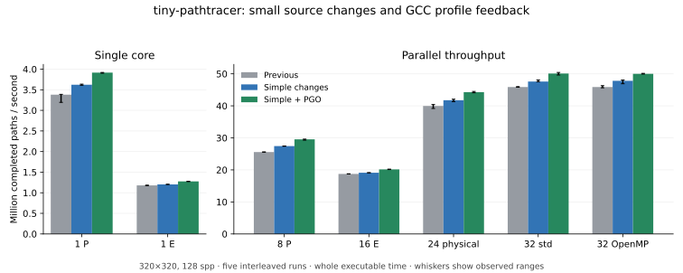

# A small optimization round with Astra and perf

The new simple source improves completed-path throughput by **7.1% on one P core** and **3.7% on all 32 logical CPUs**. GCC profile feedback raises those gains to **15.8%** and **9.2%**, respectively: **50.09 million completed paths/s** on the full CPU. The rendering source changes by about ten lines. The original ray-intersection loop remains intact; the direct-column experiment did not win and was removed.

Astra at xhigh selected and reviewed the experiments; implementation and sequential measurements were performed by the parent agent. Astra then audited timing, numerical behavior, and fresh hardware perf evidence. See [the plan](benchmarks/round3/astra-plan.md) and [the result audit](benchmarks/round3/astra-results.md).

## What changed

The ordered result vector now belongs to the worker. It is sized once for the largest possible tile and reused without clearing. Each job writes its result before the original ordered sum reads it. At 320²/128 spp, this replaces 800 per-tile constructions with at most one construction per worker. It avoids repeated initialization of roughly 150 MiB of result storage; that is source-level write work, not a claim of 150 MiB saved DRAM traffic. Small images cap the allocation to their actual maximum tile size.

On GNU libc, the sampler evaluates sine and cosine together at the same float angle; other libraries retain the original separate calls. All 16,777,216 possible sampler angles were tested: both returned components matched the original separate functions bit-for-bit on the installed library. The reference wrappers were not inlined and their assembly calls `sinf`/`cosf` separately. The original double `M_PI` expression, radius, PCG draws, hemisphere sign test, and estimator remain unchanged. GNU libc documents [combined trigonometric evaluation](https://sourceware.org/glibc/manual/latest/html_node/Trig-Functions.html); universal bit equality is not its portable contract.

`make pgo` adds an optional GCC profile-use executable. Its training uses the actual 320²/128-spp refill workload plus small std/OpenMP runs to cover team launch. Generation and use keep the same output path, source, architecture and floating-point flags. Atomic counter updates protect multithreaded training; missing/mismatched profiles are errors. Training timings are not performance scores. Flags, profile hashes and commands are retained in the metadata. [GCC profile instrumentation](https://gcc.gnu.org/onlinedocs/gcc/Instrumentation-Options.html).

## Whole-process performance

Each configuration receives one full warmup and five interleaved observations. Times include startup, preparation, rendering, HDR output, and teardown. The workload is 13,107,200 completed paths, with unchanged scene, estimator, PCG stream identities and termination policy. All 105 fast scored runs report 88,965,817 live ray segments and 89,020,640 ray slots. Each binary's HDR hash is stable across its runs and runtime choices. Float32 differences are assessed separately below.

| Configuration | Previous wall s | New source wall s | New + PGO wall s | PGO throughput gain | PGO Mpaths/s |
| --- | ---: | ---: | ---: | ---: | ---: |
| One P | 3.876198 | 3.618949 | 3.346871 | 15.82% | 3.916 |
| One E | 11.114759 | 10.891074 | 10.272614 | 8.20% | 1.276 |
| Eight P | 0.512411 | 0.477586 | 0.443652 | 15.50% | 29.544 |
| Sixteen E | 0.699136 | 0.685657 | 0.649971 | 7.56% | 20.166 |
| 24 physical | 0.327926 | 0.313852 | 0.295966 | 10.80% | 44.286 |
| 32 logical, std | 0.285691 | 0.275412 | 0.261670 | 9.18% | 50.091 |
| 32 logical, OpenMP | 0.285741 | 0.274149 | 0.262105 | 9.02% | 50.007 |



These are medians and observed ranges, not confidence intervals. The three versions' wall-time ranges do not overlap within each tested core configuration. Std/OpenMP PGO ranges overlap; there remains no established runtime winner. PGO alone adds about 8.1% P1 and 5.3% all-CPU throughput over the new source.

PGO homogeneous scaling is **7.544× / 94.30% of linear** for eight P cores and **15.805× / 98.78%** for sixteen E cores. This retains the earlier near-linear behavior while increasing absolute throughput. One E supplies about 32.6% of one favored P's rate for this version; use this calibration rather than the older kernel's 34.9%. Summing isolated P/E rates predicts about 51.74 Mpaths/s for 24 physical cores versus 44.29 measured (85.6% of that model). It remains a model with unchanged operating-rate assumptions, not measured hardware utilization. The previous [reference-cycle evidence](PERF.md) showed that package load lowers active clock ratios; this round did not remeasure mixed-core clocks or identify a power/thermal cause.

## Numerical result

The existing test suite passed 200,000 exact simple intersections, the advanced intersection corpus/stress cases, and 96 strict rendering/layout/runtime checks. An additional 56 comparisons cover tiny images, sample/tile tails, batches, fixed/refill execution, std/OpenMP and full 320²/128-spp raw renders: **28 strict comparisons are bit-identical** to the frozen baseline. All candidate std/OpenMP outputs match within their own build. Strict PGO was trained separately with contraction disabled.

Fast builds retain `-ffp-contract=fast` and introduce no fast-math/reassociation flags. Their full raw images have small differences consistent with changed contraction/code generation:

| Fast build against previous fast baseline | Changed float components | RMSE | Maximum absolute difference |
| --- | ---: | ---: | ---: |
| New source | 12,821 / 307,200 | 1.17e-9 | 5.96e-8 |
| New source + PGO | 23,121 / 307,200 | 2.05e-9 | 1.19e-7 |

The trig component test is exact, but does not establish whole-render FMA equality. Identical aggregate ray counts also do not prove identical per-path hit sequences. The strongest result is the matched strict build's complete pixel equality.

A supplemental strict timing pass used one warmup and three interleaved observations: one P improves from 4.2304 to 3.7579 s (**12.57% more throughput**); all 32 improve from 0.292573 to 0.273431 s (**7.00%**), reaching 47.94 Mpaths/s with exact pixels. One strict P baseline observation was 5.451 s while the other two were about 4.23 s; retain that spread rather than treating three medians as a confidence result.

## Fresh perf interpretation

Root perf observes an ordinary-user renderer, pinned through taskset before tracing. P and E PMUs are explicitly separated. Three interleaved counts per one-core version include launcher, startup, tracing and HDR output; all events run for 99–100%. Scored throughput above is unprofiled. Production/debug `.text` was verified byte-identical separately for baseline and final PGO before 499-Hz DWARF cycle sampling; no samples were reported lost.

| P-core metric per completed path | Previous | New source | New + PGO |
| --- | ---: | ---: | ---: |
| User cycles | 1,759.5 | 1,643.0 | 1,518.4 |
| Retired instructions | 4,480.1 | 4,362.5 | 4,160.6 |
| Retired branch mispredictions | 7.920 | 5.676 | 6.144 |
| IPC | 2.546 | 2.655 | 2.740 |
| Active/reference cycles | 1.8684 | 1.8700 | 1.8686 |

PGO versus previous cuts P cycles/path by **13.7%** and instructions/path by **7.1%** with nearly unchanged active/reference ratios. E cycles fall from 3,786.1 to 3,513.4 (7.2%) while IPC stays near 1.184 and active/reference ratios stay near 1.40866. This supports less work/better execution rather than an isolated-core frequency boost as the primary measured explanation. It does not isolate how much each compiler transformation contributes.

PGO is faster than the new simple build despite more branch mispredictions per path. The lower branch total also makes its miss *percentage* higher. Neither the fewest misses nor the highest IPC is the objective; completed work and cycles matter together.

The separate P load pass counts about 19.55 → 18.04 billion retired loads, roughly 7.7% fewer. Retired L1-missing loads remain small (about 214k →196k); these are demand-load events, not byte traffic. FP-divider activity rises slightly in absolute count, 2.807B →2.853B, while total cycles fall. Its activity ratio therefore rises; this is not a regression or removable stalled-time fraction. No new controller traffic/bandwidth-capacity claim is made.

P topdown slot fractions change from 46.5% to 50.2% retiring, 22.0% to 18.5% bad speculation, 4.1% to 2.2% frontend bound, and 27.3% to 29.2% backend bound. Total slots shrink. A larger backend fraction of a smaller total does not show a new memory bottleneck; these are issue opportunities, not seconds.

Inlining moves costs into the enclosing worker: PGO worker self is about 88% on P and 93% on E. DWARF inclusive source attribution is narrower: intersection about **52.7% P / 74.5% E**, scatter including callees **35.8% /20.2%**, and nested hemisphere sampling **23.9% /13.8%**. Parent/child shares overlap and must not be added. These are approximate cycle-sample locations, with optimized-source attribution/skid limits. Removing an out-of-line function from the report does not remove its computation.

## What was rejected

Direct ray columns retained exactly the existing expressions, but three-run P screening did not establish a gain: previous 3.8752 s, buffer-only 3.8561 s, refactored ray adapter 3.9237 s, direct columns 3.8972 s. The adapter refactor itself was slower. Both it and the column dispatch/type were removed from production.

The experiments are preserved as ordered [patches](benchmarks/round3/patches/): 01 buffer, 02 columns, 03 optional trig switch. Apply to `47ced90` in that order; column source hashes were reconstructed and checked. The later production source restores the original interfaces. Prototype PGO results and numerical comparisons belong to that prototype, not the final implementation. The per-binary [manifest](benchmarks/round3/manifest.json) distinguishes their source/flag/binary provenance from current shared-header hashes.

## Reproduction

```sh
make simple
./build/pathtracer_simple 128 320 build/simple.hdr --kernel rays --batch 8 --refill --threads 32
make pgo
./build/pathtracer_simple_pgo 128 320 build/pgo.hdr --kernel rays --batch 8 --refill --threads 32
make test-compute test-sincos
```

To prepare the named binaries used by the comparison harness, run from the repository root:

```sh
mkdir -p build/pass3 build/pass3-baseline-source
git archive 47ced90 renderer_common.h render_driver.h simple_kernels.h pathtracer_simple.cpp | tar -x -C build/pass3-baseline-source
ROUND3_FLAGS='-isystem . -O3 -std=c++17 -Wall -Wextra -Wpedantic -march=native -pthread -fopenmp'
c++ $ROUND3_FLAGS -ffp-contract=fast build/pass3-baseline-source/pathtracer_simple.cpp -o build/pass3-baseline
c++ $ROUND3_FLAGS -ffp-contract=off build/pass3-baseline-source/pathtracer_simple.cpp -o build/pass3-baseline-strict
make simple build/pathtracer_simple_strict
cp build/pathtracer_simple build/pass3-simple
cp build/pathtracer_simple_strict build/pass3-simple-strict
python3 benchmarks/build_pgo.py --binary pass3-final-pgo --cpu 8
python3 benchmarks/build_pgo.py --binary pass3-final-pgo-strict --cpu 8 --flags "$ROUND3_FLAGS -ffp-contract=off"
python3 benchmarks/validate_final.py
python3 benchmark_compute.py --matrix benchmarks/round3/final-matrix.json --output build/pass3/final-results.json --runs 5
```

CPU mappings are specific to this workstation. Source, compiler flags, training commands, outputs, profiler identity hashes and raw rows are retained in [benchmarks/round3](benchmarks/round3/).

Perf reproduction uses `sudo -v` followed by `python3 benchmarks/profile_round3.py` after preparing the byte-identical debug binaries named in that script. It retains raw recordings under ignored `build/pass3/perf`; committed JSON/CSV and reports contain the measured evidence. Machine settings were retained throughout. PGO is trained for this workload; retrain and measure when changing the scene or main workload.

The next modest experiment identified by Astra is incremental sample/x/y indexing in refill, if final assembly still performs integer division/remainder. The complete refill lambda accounts for only about 4.8% of P samples and 2.7% of E samples, including indispensable camera work, so its available benefit is limited. It remains a proposal rather than part of this measured change.
