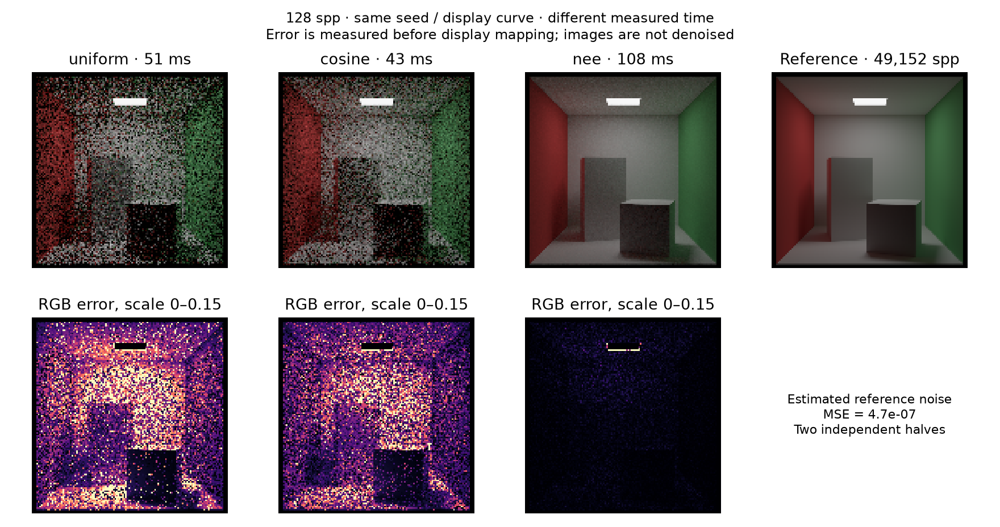
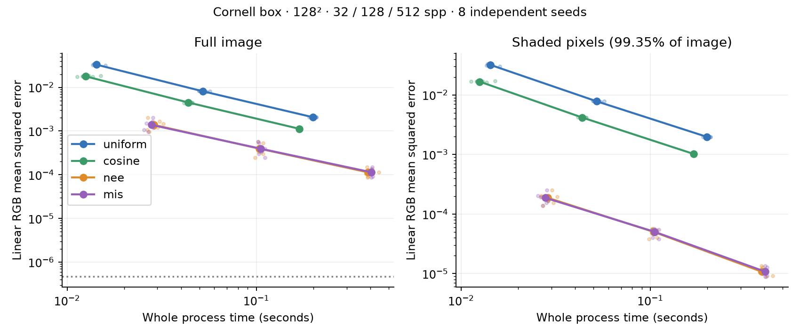
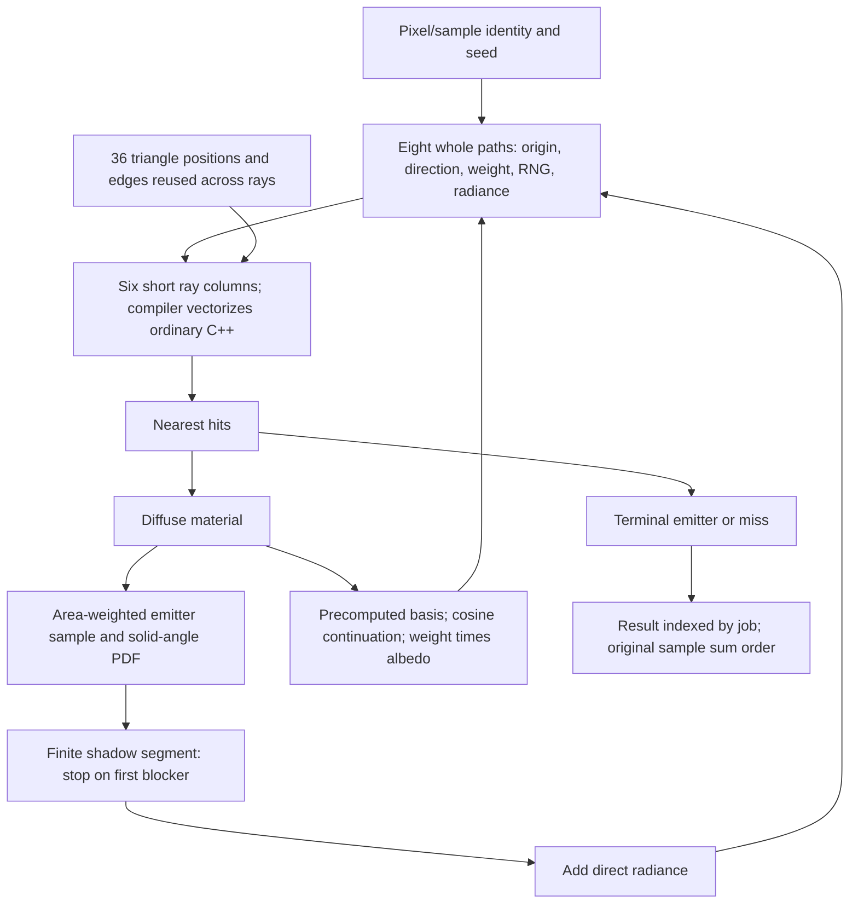

# Sampling, intersection arithmetic, and random numbers

Direct light sampling gives about **10× better full-image error per second** on this Cornell box. Cosine continuation gives about **2×**. The new intersection formulas and RNGs did not establish a throughput improvement, so the default intersection stays RayScene and the default generator stays PCG32. `pathtracer_quality.cpp` defaults to cosine continuation plus next-event estimation (NEE); MIS is optional.

Astra at xhigh selected/reviewed the computation and estimator experiments, then audited numerical behavior, timing and perf. The parent implemented and measured sequentially on blacknoir's i9-14900K. Code is in `/home/blacknoir/Projects/tiny-pathtracer`; all executables, raw images, profiles and temporary files are under `build/`.

## Why better samples win

Manuka §2.4 compares sample cost with variance reduction: halving per-sample standard deviation can justify four times the cost for equal asymptotic error/time. Its production architecture is much larger than this renderer; we test that efficiency principle here rather than reproducing its batch-shading system. [Authors' manuscript, page 5](https://jo.dreggn.org/home/2018_manuka.pdf).

Uniform continuation often wanders through the scene without finding the small emitting panel. Cosine sampling chooses diffuse directions with PDF `cos(theta)/pi`, so the Lambertian continuation weight simplifies from `rho * 2*cos(theta)` to `rho`. NEE explicitly samples a point on an emitter, checks visibility, and adds its weighted contribution at each eligible diffuse vertex. [PBRT cosine sampling](https://pbr-book.org/4ed/Sampling_Algorithms/Sampling_Multidimensional_Functions), [PBRT direct lighting and MIS](https://pbr-book.org/4ed/Light_Transport_I_Surface_Reflection/A_Better_Path_Tracer).

For emitter selection proportional to area, joint area PDF is `1 / total_emitter_area`. From the actual offset ray origin, its solid-angle PDF is `pL = distance² / (total_area * cos_light)`. The direct term is `beta * rho * Le * cos_surface / (pi * pL)`. Both the sampled connection and continuation-hit MIS use that same origin. NEE suppresses continuation emitter hits while retaining primary camera emission; MIS uses complementary power weights. Radiance accumulates with `+=`. Emitters remain terminal.

The camera, half-pixel jitter domain, scene, one-sided hits and 24-visit target remain the same. NEE runs at visits 0..22; its emitter uses the next visit. There is no extra light connection at diffuse visit23. No Russian roulette, clamping or denoising is added.

## Image accuracy per time

128² image,128 spp,32 std workers, eight independent seeds, ordinary C++ ray intersection, `-O3 -march=native -ffp-contract=fast`, no PGO. Time includes the entire executable and raw RGB output. MSE uses unclamped linear RGB. Efficiency is the ratio of **mean per-run MSE×wall-time products**, not a ratio of one lucky image or a mean of pairwise ratios.

| Sampling | Median wall ms | Mean MSE | Efficiency vs uniform |
| --- | ---: | ---: | ---: |
| uniform | 52.03 | 0.0081343 | 1.00× |
| cosine | 43.67 | 0.0044969 | 2.17× |
| nee | 103.88 | 0.0003948 | 10.34× |
| mis | 105.29 | 0.0003948 | 10.25× |





All modes were measured at32/128/512 spp. NEE/MIS mean MSE differs by less than0.021%; their runtime ranges overlap and ordering changes with budget. NEE is the simpler default. These are observed medians/ranges on a shared workstation, not confidence intervals or a universal scene ranking.

The independent reference averages24 images of2048 spp in float64:49,152 spp. Two12-image halves estimate reference-noise MSE **4.67e-07**, about0.12% of NEE128-spp full-image error. A separate32² test averages8×4096-spp images per estimator. Difference-MSE/noise estimates are1.088 for uniform,0.899 for cosine and1.008 for NEE against MIS. Uniform's mean brightness difference is2.31 estimated standard errors; this check finds no gross discrepancy, and is not a proof of unbiasedness.

The mask `max(reference RGB)<2` includes99.35% of pixels. At128 spp, NEE's efficiency over uniform is roughly78× in that mask;106 excluded bright-edge pixels account for about87% of its full-image error. This is a reference-intensity mask, not a geometry-defined nonemitter mask. Camera-jitter stratification is now a strong next experiment.

## The computation and data flow



The eight slots serve the measured ray-parallel intersection loop; the new estimator needs no intrinsics or global wavefront queues. Whole-path AoS remains convenient for shading and RNG, with small local columns for intersection. Precomputed bases reuse geometry work. Shadow visibility asks only whether a finite segment is blocked; the any-hit control exits early instead of continuing to find a closest hit. Any/nearest outputs agree in the tested scene, but their all-core timing ranges overlap. The endpoint emitter and exact coplanar emissive seam neighbors are excluded; actual near-endpoint opaque blockers remain in the segment.

## Same-estimator arithmetic experiments

320²/128 spp, one warmup followed by five scored P/all-CPU observations and three E observations, interleaved. Each PGO candidate was trained separately with the same training workload and flags. Times are whole-process seconds.

| Version | One P | One E | 32 logical CPUs |
| --- | ---: | ---: | ---: |
| baseline-pgo | 3.351857 | 10.283247 | 0.261484 |
| cursor-pgo | 3.349326 | 10.264466 | 0.260989 |
| numerator-pgo | 3.395155 | 10.311385 | 0.264613 |

The refill cursor replaces per-job quotient/remainder calculations with incrementing sample/x/y counters. Strict pixel comparisons pass, but timing ranges overlap; it is a bookkeeping simplification with no established speedup. The numerator kernel compares raw barycentric/distance numerators, carries the winning determinant, and normalizes once per queried ray lane, including misses. It loses after PGO. The precomputed-plane kernel removes candidate cross products but its untrained screening time is21.07s on oneP versus3.63s for the ordinary baseline. It was not pursued through PGO; fewer arithmetic expressions alone do not predict performance.

Both alternate kernels are explicit experiments in `pathtracer_explore.cpp`. A fixed corpus of130,397 camera/bounce/random rays is checked against old float and double tests for0/1/7/8/9/17/36 triangles, plus127 boundary/tie rays. No hit-ID/presence differences appear there; full fast renders have changed paths/ray counts and rounding. Maximum matched-hit relative t error is2.65e-5 for numerator and5.22e-5 for plane. An extreme-scale numerator overflow case is deliberately reproduced; these are not universal robust or bit-preserving replacements.

## Core scaling and perf

MIS128²/512 spp, three whole-process observations per configuration:

| Configuration | Median wall s |
| --- | ---: |
| P1 | 5.413015 |
| P8 | 0.726683 |
| E1 | 12.318257 |
| E16 | 0.811983 |
| physical24 | 0.486734 |
| std32 | 0.425321 |
| omp32 | 0.408559 |

EightP reach **7.449× / 93.1% of linear**; sixteenE reach **15.171× / 94.8%**. Std/OpenMP ranges overlap. Hybrid scaling should be compared with calibrated P/E rates rather than treating32 logical CPUs as32 identical cores.

Root perf observes an ordinary-user renderer, pinned to CPU8 or16, with explicit P/E PMUs. Hardware events run for99–100% of the interval. Throughput tables are unprofiled. Three P count observations give:

| Per completed path, P core | Historical PGO | Cursor PGO | Numerator PGO |
| --- | ---: | ---: | ---: |
| User cycles |1518.1|1516.3|1540.7|
| Retired instructions |4160.6|4127.5|4149.2|
| IPC |2.741|2.722|2.693|

A separate divider/load pass measures2.853B→1.174B FP-divider-active counts for baseline→numerator, approximately59% less, while cycles increase. Divider activity is not stalled time; removing divisions was insufficient to improve useful throughput. No new DRAM-bandwidth conclusion follows from these events.

Sampling P counts are1633/1191/3779/3838 cycles per completed path for uniform/cosine/NEE/MIS. NEE's additional work buys much lower image error. A499-Hz DWARF profile of current NEE reports about2K cycle samples, zero lost, with byte-identical production/debug `.text` (SHA256 `6632665dee382482299aa4beec7841c59934b3441e66217947957db642c484d4`). Approximate inclusive locations: visibility50.36%, continuation intersection20.16%, cosine sampling11.60%, within scatter72.60%. Parent/child shares overlap. Shadow traversal is now a more promising compute target than the already-small RNG contribution.

## Faster RNG experiment

PCG32 remains default. Two optional ordinary-C++ builds use xoroshiro128++ and128**, each retaining16 bytes per path. The master seed is mixed once during option parsing, combined with pixel/sample identity, then expanded with two SplitMix64 outputs. Both state words mutate; PCG's increment is fixed. The upper24 output bits retain the existing float grid. Hashed initialization is not a proof of independent/disjoint subsequences. [Authors' PRNG discussion](https://prng.di.unimi.it/).

A seeded-short-stream microbenchmark, GCC-O3/native, oneP, gives xoroshiro++ about0.318ns/draw versus PCG0.444 at40 draws/seed. At two draws/seed it is slower:0.565 versus0.425. Compiler optimization and amortized setup make this a diagnostic, not the renderer ranking.

| RNG, ordinary uniform renderer | One P,320²/128spp | One E,160²/32spp | 32 CPUs,320²/128spp |
| --- | ---: | ---: | ---: |
| pcg32 | 3.632823 | 0.678819 | 0.277602 |
| xoroshiro128++ | 3.682801 | 0.679950 | 0.275594 |
| xoroshiro128** | 3.681728 | 0.683599 | 0.278728 |

One warmup and three scored independent seeds are interleaved. No reliable whole-render gain is established; all-core ranges overlap. Eight-seed128-spp image errors do not favor replacing PCG, and bright-edge variance limits this small sample's statistical ranking. Independent high-sample NEE means agree with the PCG MIS target at approximately estimated noise (difference-MSE/noise ratios0.996/1.199 for++/**). Known reference vectors,1M-value bounds/moments/histograms/lag correlation,200k neighbor-seed stream checks and12 runtime/layout parity checks pass. These are targeted checks, not a complete TestU01 certification. Public-domain provenance is in `licenses/XOROSHIRO-NOTICE`.

## Reproduction and provenance

```sh
make quality explore quality-rng
./build/pathtracer_quality 128 320 build/nee.hdr --sampling nee --batch 8 --refill --threads 32
./build/pathtracer_quality 128 320 build/cosine.hdr --sampling cosine --batch 8 --refill --threads 32
./build/pathtracer_quality_xoroshiro_pp 128 320 build/rng.hdr --sampling nee --batch 8 --refill --threads 32
make test-quality test-explore test-rng test-compute
make quality-pgo  # optional; its performance is not scored in this report
```

Raw observations, commands, hashes, scripts, Astra audits and perf exports are under `benchmarks/round4/`; raw image arrays, binary/profile data and the original Manuka PDF are kept in ignored `build/pass4/`. The quality/scaling curves were recorded before optional RNG integration; the exact pre-RNG driver is archived and its hash checked against metadata. The later RNG dataset uses final source and reproduces PCG image MSE exactly. Per-binary PGO metadata distinguishes frozen historical binaries from current shared-header hashes. Rebuilding profiles or changing a sampling mode/seed does not promise bit equality across generators or contracted builds.

Next experiments: stratify the current camera jitter domain; batch finite shadow queries or simplify their bounded intersection arithmetic; test estimator agreement at additional depths/scenes before adopting more elaborate sampling.
