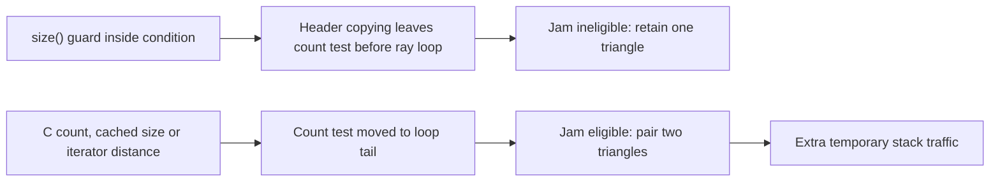

# Clang comparison and the C-array loop trigger

On blacknoir's i9-14900K, the renderer uses actual C arrays: `Triangle triangles[64]` and eight-element
`float`/`int` ray columns. Both GCC 15.2 and Clang 20.1.8 generate eight-wide AVX2
intersection arithmetic. This pass compares both compilers without changing
the rendering algorithm, and isolates why the original vector loop escaped
GCC's expensive unroll-and-jam transformation.

## Compiler measurements

|Sampling / CPUs|GCC STL s|Clang STL s|GCC C arrays s|Clang C arrays s|Clang arrays vs GCC arrays|
|---|---:|---:|---:|---:|---:|
|uniform/P1|3.615311|3.963715|3.631773|3.563744|-1.87%|
|uniform/all32|0.273611|0.301878|0.274034|0.275084|+0.38%|
|nee/P1|8.286874|9.740295|8.152587|8.205337|+0.65%|
|nee/all32|0.562894|0.632064|0.550769|0.553413|+0.48%|

Clang arrays recover the untuned GCC-array gap without a GCC-specific flag.
Against tuned GCC arrays, the observed one-P uniform improvement is 1.87%;
NEE is 0.65% slower. All32 differences are 0.38% uniform and 0.48% NEE, with
observed ranges overlapping. The GCC/libomp control medians are 0.280762 s
uniform and 0.553207 s NEE, versus libgomp's 0.274034/0.550769 s. The runtime
choice therefore contributes to the all32 comparison and prevents a pure
compiler-only attribution there.

Shared-workstation outliers occurred in scored NEE P1 runs: GCC STL 9.89 s
and Clang plain 10.44 s. They remain in the five-run records and observed
ranges; no scored observation was discarded. Medians are comparisons of this
configuration, not confidence intervals or a universal compiler ranking.

320×320, 128 samples/pixel, PCG 42, eight-ray AoS refill, OpenMP. P1 is CPU 8;
all32 uses CPUs 0..31. Each configuration has one warmup and five scored
interleaved observations. Time includes startup, rendering, raw image output
and teardown; image hashing is outside the timed interval. Both compilers use
O3, native architecture and fast FP contraction, with no fast-math or PGO.
GCC plain retains its measured no-jam flag; Clang plain uses ordinary O3.
Clang outputs are separate `build/pathtracer_*_clang` executables.

GCC normally links libgomp; Clang links LLVM libomp 20. The additional GCC-plain
libomp control uses the same compiled operations with LLVM's GNU OpenMP ABI
entry points. Its normalized disassembly is instruction-for-instruction
identical to GCC plain's, including 21298 instructions across the executable.
It is a runtime/ABI control measured on all32, not another shader optimization.
The compilers use the same installed libstdc++ for the STL reference and the
same glibc math functions. Clang's C++ driver also links libstdc++ into plain,
although plain uses no STL containers, algorithms, streams or C++ threads;
its dynamic imports contain no GLIBCXX/CXXABI symbols.

|Mode/version|Cycles/path|Instructions/path|IPC|Loads/path|Stores/path|Active/reference cycles|
|---|---:|---:|---:|---:|---:|---:|
|uniform/gcc-stl|1631.5|4388.3|2.690|1461.6|447.7|1.8544|
|uniform/clang-stl|1771.2|5320.7|3.004|1359.1|704.9|1.8546|
|uniform/gcc-plain|1632.1|4384.5|2.686|1423.6|441.6|1.8571|
|uniform/clang-plain|1606.0|4194.6|2.612|1070.0|415.8|1.8549|
|nee/gcc-stl|3770.2|10741.5|2.849|3566.2|650.8|1.8577|
|nee/clang-stl|4413.3|12835.6|2.908|2984.4|805.7|1.8573|
|nee/gcc-plain|3711.3|10350.1|2.789|3277.4|442.5|1.8554|
|nee/clang-plain|3708.8|10030.1|2.704|2576.8|416.2|1.8566|

Clang plain reduces uniform instructions/path 4.33% and cycles/path 1.60%
relative to GCC plain. NEE cycles/path differ by 0.07%, despite 3.09% fewer
instructions and about 21% fewer retired loads in Clang. That load-count
saving did not translate into lower total NEE cycle cost in these observations.
Clang STL
executes about 21% more instructions for uniform and 19% more for NEE than
GCC STL. Its higher IPC does not make its total work or elapsed time lower.
Active/reference ratios differ by less than 0.3% within each workload; hardware
running fractions are 99–100%. No measured cache-stall or DRAM-bandwidth
conclusion follows from these load/store counts.

Perf measurements are separate from wall scoring, on CPU 8 with explicit
cpu_core user events. Retired loads/stores count instructions, not DRAM bytes.
Recorded running fractions and complete launch commands accompany the counts.

## The specific GCC trigger

The original loop calls `triangles.size()` in its condition. Installed
libstdc++ 15 calculates end-minus-begin and marks a negative length unreachable.
This is an optimizer assumption for a well-formed vector. The implementation
is also present in the [GCC 15.2 source](https://raw.githubusercontent.com/gcc-mirror/gcc/releases/gcc-15.2.0/libstdc++-v3/include/bits/stl_vector.h).

At GCC's `ch2` header-copying pass, that guard changes the loop's control-flow
shape. The original eight-ray loop's copied prefix ends at the negative-length
guard; its actual count test remains before the inner ray loop at the later
unroll-and-jam pass. GCC's jam implementation requires outer exits to follow
the inner loop, so this form is rejected. The C-array count condition becomes
a tail test after header copying and satisfies that requirement.
The condition is visible in the [GCC 15.2 jam source](https://raw.githubusercontent.com/gcc-mirror/gcc/releases/gcc-15.2.0/gcc/gimple-loop-jam.cc).
This last rejection follows from the observed control flow and the source's
eligibility check; GCC's dump does not print a dedicated rejection message.

Two counterfactual controls establish that storage is not the deciding factor:

```cpp
// Same std::vector storage: caching the size enables the costly transformation.
const int triangle_count = int(triangles.size());
for (int i = 0; i < triangle_count; ++i) { /* unchanged ray loop */ }
```

Replacing size() with iterator distance in the original condition also removes
the size assumption and enables factor-two jam. Conversely, a diagnostic
checked-count helper in the C-array loop condition recreates the guard and
suppresses jam without the compiler flag:

```cpp
static int checked_count(const SceneData& scene) {
    if (scene.count < 0) __builtin_unreachable();
    return scene.count;
}
// Same Triangle triangles[64] storage and unchanged inner arithmetic.
for (int i = 0; i < checked_count(scene); ++i) { /* unchanged ray loop */ }
```

The assumption is valid for this internally constructed scene's 0..64 count
contract. This diagnostic is not a runtime bounds check and is not promoted as
a production workaround; the explicit compiler option is clearer.

|GCC control|Storage|Jam factor|160²/128-spp uniform wall s|
|---|---|---:|---:|
|Original condition|std::vector|1|0.897425|
|Cache size before loop|same std::vector|2|1.014539|
|Use iterator distance|same std::vector|2|1.013333|
|Plain count condition, ordinary O3|same C array|2|0.972406|
|Checked count in condition, ordinary O3|same C array|1|0.899478|

These small-screen medians have one warmup and two scored interleaved runs on
CPU 8. Factor 1 means no jam transformation was applied; all loops still use
eight-wide SIMD. The count/view alternatives, a reference-returning maximum
and a once-before-loop positive-count assumption retain factor-two jam. The
position and control-flow shape of the condition matters here.



This refines round six's initially unresolved trigger. It does not imply that
std::vector always inhibits jam, that size caching is generally slower, or
that extra assumptions always improve performance. The compiler pipeline and
this installed library implementation produce the effect in this renderer.

## Clang loop and validation

Clang plain keeps the fixed-eight `intersect_batch` helper out-of-line. Its
main triangle loop is 0x10a20–0x10bd9: one triangle, 72-byte stride, one YMM
divide, 84 static assembly instructions and 14 YMM stack operands. GCC's fixed
inlined main loop has 84 instructions and 17 stack operands. These static counts
exclude the surrounding packing/call work and are not a throughput prediction.
Clang STL retains a generic count-taking helper, with runtime vector-loop
guards and scalar remainder handling. GCC specializes/inlines the actual
eight-ray paths. This is another code-shape difference, not container overhead
measured in isolation.

A separate Clang `-fno-unroll-loops` screen changed plain medians by less than
1% and did not recover the STL gap; its STL NEE result improved about 2% but
remained slower. It is not used in the primary score or production targets.

All 44 strict cross-compiler image comparisons are byte-identical to GCC, with
matching work counts: all four sampling modes, widths 1/9/17/32/64 with tails,
and full 320²/128-spp uniform/NEE on both Clang sources. All 80 additional
1-to-4/32-worker scheduling comparisons have identical pixels and work.

Fast-contracting builds differ slightly between compilers. Clang plain versus
GCC plain has uniform RMSE 5.89e-9 / max 2.65e-6 and NEE RMSE 8.38e-6 / max 0.00262.
These are disclosed cross-compiler arithmetic differences; fast images are
not claimed byte-identical. Every version has stable pixels and work counts
across repetitions and CPU scopes. The GCC/libomp control's fast uniform and
NEE images are exactly identical to GCC/libgomp's.

`make clang` builds separate Clang fast targets. Strict targets are
`build/pathtracer_plain_clang_strict` and
`build/pathtracer_quality_clang_strict`. Override `CLANGXX` for another Clang
installation. The default GCC targets and renderers retain their behavior.
`benchmarks/round7/` preserves build commands/hashes, compiler-pass excerpts,
loop audits, numerical checks, screen/full observations and perf exports.
Full dumps, assembly, objects, executables and raw images stay in ignored
`build/pass7/`.
