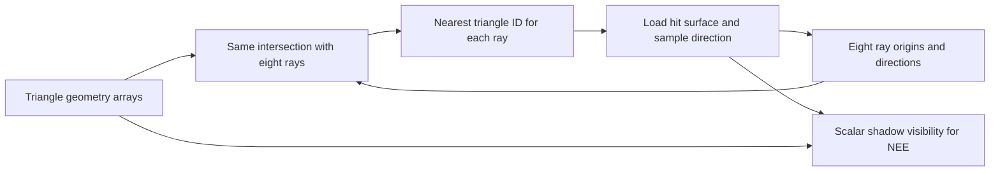

# Triangle storage with the same eight-ray computation

`pathtracer_triangles.cpp` tests a `struct Triangles` owner made entirely of
fixed C arrays. It preserves the current STL-free renderer's intersection,
sampling, random streams, triangle order and OpenMP scheduling. On blacknoir's
i9-14900K, scalar geometry columns improve Clang's uniform rendering modestly;
`Float3` field arrays improve its single-core NEE rendering. Neither gives a
measured NEE improvement on all 32 threads. GCC does not benefit in this pass.
The original `pathtracer_plain.cpp` remains the reference.

## What was changed

The new renderer is a mechanical copy of plain. Its source differs only in its
introductory comment, the storage-header include, the triangle owner type and
the two scene-insertion assignments. Intersection and integrator expressions
are unchanged. `triangle_storage.h` contains four compile-time representations:

|Macro|Name|Geometry|Surface values|
|---|---|---|---|
|0|aos|Original `Triangle records[64]`|In each record|
|1|split|`Geometry geometry[64]`, each containing p/e1/e2|Separate `Surface surfaces[64]`|
|2|fields|`Float3 p[64], e1[64], e2[64]`|Separate surface array|
|3|soa|Separate x/y/z float arrays for p, e1 and e2|Separate surface array|

Every representation offers the same inline `operator[]` and `set`. The AoS
wrapper is a control for returning a temporary `Triangle` rather than a
reference to the original record. We screened it separately from the physical
layout changes. In the intersection assembly, unused surface loads and whole
temporary copies are eliminated; the source convenience does not require
constructing a 72-byte triangle on each loop iteration.

The scalar-column representation is essentially:

```cpp
struct Float3Array { float x[64], y[64], z[64]; };
struct Triangles {
    Surface surfaces[64];          // normal, albedo, emission
    Float3Array p, e1, e2;          // intersection geometry
};
```

There are still eight independent rays in each compiler-vectorized batch. For
each triangle, its nine scalar geometry components are broadcast to those rays.
This pass changes storage, not which dimension is vectorized, and adds no SIMD
intrinsics, queues or STL containers.



Each original triangle contains 72 bytes, of which 36 are intersection geometry.
All four owners retain 4,608 bytes of capacity for 64 triangles. The 36 active
triangles have 1,296 bytes of geometry payload and 1,296 bytes of surface payload.
Unused capacity and cache-line alignment affect footprint; these payload counts
are not measured cache traffic. This is already a small scene. Layout gains here
can come from compiler instruction choices rather than removing DRAM traffic.

An earlier `FlatScene` experiment also used triangle SoA, but it vectorized
across triangles for one ray and then reduced candidates. Its speed comparison
changed both storage and execution. The present experiment keeps the faster
eight-ray computation and isolates storage more closely.

## Full measurements

|Compiler/layout|Uniform P1|Uniform all32|NEE P1|NEE all32|
|---|---:|---:|---:|---:|
|gcc-original|3.589698|0.274376|8.155359|0.548231|
|gcc-fields|3.616935|0.277167|8.400923|0.561802|
|gcc-soa|3.602507|0.275115|8.319813|0.562478|
|clang-original|3.534738|0.272445|8.183613|0.549372|
|clang-fields|3.487017|0.273600|7.964336|0.552475|
|clang-soa|3.443086|0.260478|8.327152|0.550280|

Seconds, 320×320, 128 samples/pixel, PCG seed 42, batch eight with refill,
OpenMP. P1 is CPU 8; all32 explicitly selects CPUs 0..31. One warmup and five
scored observations per configuration, shuffled and interleaved. Time includes
startup, raw output and teardown; hashing is outside the timed interval.
GCC 15.2 and Clang 20.1.8 use O3/native and fast FP contraction. GCC keeps the
same no-jam flag in every compared build. GCC uses libgomp, Clang uses libomp;
layout comparisons are within each compiler/runtime combination.

Clang SoA uniform time falls 2.59% on P1 and 4.39% on all32. Clang fields NEE
falls 2.68% on P1, but its all32 median is 0.56% higher, with overlapping ranges.
Clang scalar SoA NEE is 1.75% slower on P1. GCC fields/SoA NEE is 3.01%/2.02%
slower on P1 and 2.48%/2.60% slower on all32. The small uniform GCC differences
do not establish an improvement.

No scored run was discarded. One Clang SoA uniform P1 observation was 5.272958 s,
while the other four were 3.438185–3.444701 s. Full ranges and all observations
are in `benchmarks/round8/summary.json` and `full-results.json`. These medians
are workstation observations, not confidence intervals.

The P1-to-all32 speedup is 12.97×→13.22× for Clang uniform original→SoA, and
14.90×→14.42× for Clang NEE original→fields. All32 mixes eight P cores, their
SMT siblings and sixteen E cores; it is not 32 equivalent physical P cores.
These endpoint measurements do not establish linear scaling or isolate why
the single-core NEE improvement vanishes at all32. No new intermediate-core
scaling sweep was performed in this storage pass.

The preliminary 160×160 screen includes all four layouts and the original,
both compilers, uniform and NEE, with one warmup and three scored observations.
Those 80 runs selected fields and scalar SoA for the 144-run full comparison.
The wrapper itself affects some NEE timings, so changes relative to the original
should not be attributed entirely to physical layout.

## Assembly and perf

|Compiler/layout|Loop instructions per triangle|YMM stack operands|Permutes|Vector divides|
|---|---:|---:|---:|---:|
|Clang original/AoS wrapper/split|84|14|3|1|
|Clang fields|83|13|3|1|
|Clang scalar SoA|79|12|0|1|
|GCC original/fields/scalar SoA|84|17|0|1|

Counts cover the actual triangle-loop body, including its backedge. Clang
uses direct memory scalar broadcasts in SoA instead of loading paired components
and permuting their halves. Its geometry loads address only the nine scalar
columns. GCC already used scalar broadcasts and gains no instruction-count or
stack-reference reduction in any of its four inlined sampling-mode loops.
The divide, intersection arithmetic and nearest-hit comparisons remain.

YMM stack operands include explicit ray/result arrays and compiler temporaries;
they are not all register spills and do not count DRAM bytes. Raw decoded loop
snippets and scripts are archived with the results.

|Mode/layout|Cycles/path|Instructions/path|IPC|Loads/path|Stores/path|
|---|---:|---:|---:|---:|---:|
|uniform/clang-original|1606.5|4195.5|2.612|1070.3|415.9|
|uniform/clang-fields|1586.6|4192.0|2.642|1058.7|427.4|
|uniform/clang-soa|1566.5|4053.8|2.588|1147.8|396.0|
|nee/clang-original|3711.6|10030.2|2.702|2576.8|416.2|
|nee/clang-fields|3627.3|10576.1|2.916|2894.9|442.8|
|nee/clang-soa|3777.4|10800.9|2.859|3713.0|437.8|

For uniform, scalar SoA reduces total instructions/path 3.38% and cycles/path
2.49%, while increasing retired loads/path 7.25%. Removing component shuffles
does not imply fewer load instructions: the original loads component pairs,
where SoA broadcasts each scalar directly. The nine geometry values still
contain the same 36 payload bytes.

For NEE, fields executes 5.44% more instructions and 12.35% more loads, but
uses 2.27% fewer cycles; its measured IPC rises. Scalar SoA increases NEE
instructions 7.69%, loads 44.10% and cycles 1.77%. The eight-ray assembly count
alone misses scalar shadow visibility and shading. This pass does not identify
a unique microarchitectural cause for fields' NEE gain, or for its loss at all32.

Perf was run separately from wall-time measurements: two interleaved observations
per Clang version/mode, CPU 8, user-mode P-core events, ordinary-user rendering
under privileged counter collection. Counter running fractions are 99–100%;
active/reference cycle ratios are 1.8652–1.8749, within 0.52%. Retired loads/stores are
instruction counts, not byte traffic or cache-stall measurements. They cannot
prove that either workload is DRAM-bound or explain the all32 result on their own.

## Correctness and use

All 200 strict comparisons passed with identical pixel bytes and work counters:
160 across four layouts, both compilers, four sampling modes and five small/tail
workloads; eight additional full 320×320×128 uniform/NEE comparisons for fields
and scalar SoA; 32 checks on four and 32 threads. The strict builds disable FP
contraction. The tested counters are completed paths, rays, ray slots, batch
calls and shadow rays.

Fast GCC fields and SoA images are byte-identical to fast GCC original for both
full workloads. Clang fields NEE is also byte-identical to its original. Clang
uniform fields/SoA RMSE is 6.14e-10/3.39e-9; scalar SoA NEE RMSE is 2.61e-6,
maximum channel difference 8.91e-4. Fast contraction can choose different
rounding after a representation change. The strict equality establishes the
unchanged computation; fast results and work records remain archived.

Sixteen GCC AddressSanitizer/UndefinedBehaviorSanitizer renders passed, covering
fields and scalar SoA, all four sampling modes, and one/32 threads. Unsuppressed
Clang LeakSanitizer reported a 224-byte allocation through `___kmp_allocate` in
libomp for both the unchanged original and fields. Those baseline/control logs
are preserved; no suppression or application-source fix was added. This limits
the Clang leak check and does not identify a new storage-layout leak.

The Makefile's four fast candidate binaries have exactly the same SHA-256 hashes
as their scored experimental binaries. Their names change, not their compiled
contents.

```sh
make triangles triangles-clang
make build/pathtracer_triangles_clang_fields
./build/pathtracer_triangles_clang_soa 128 320 build/soa.hdr --sampling uniform --threads 32
./build/pathtracer_triangles_clang_fields 128 320 build/fields.hdr --sampling nee --threads 1 --cpus 8
make build/pathtracer_triangles_strict_soa build/pathtracer_triangles_clang_strict_fields
```

Suffixes `aos`, `split`, `fields`, `soa` choose the representation; `strict_`
appears before the layout suffix in strict targets. Named outputs remain in
`build/`. The dedicated experiment retains each layout so future scene and
compiler comparisons can reproduce both wins and regressions.

The next focused computation change would be precomputing which triangles each
emitter's shadow rays must skip. The current visibility loop repeatedly checks
emission, matching normals and exact coplanarity even though the scene is static.
Moving those decisions to scene preparation could remove work from every shadow
ray. That proposal was not implemented or scored here. Another candidate is
ordering shadow occluders to reach a blocking hit sooner; nearest-hit paths must
still preserve their distance/tie semantics.

Build commands, source/binary hashes, checks, timing records and perf counters
are in `benchmarks/round8/`. No baseline source, RNG, estimator or camera change
is included in this pass.
