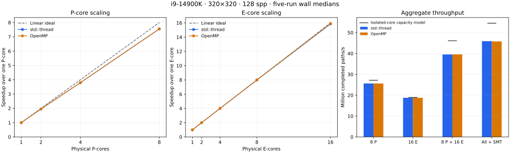
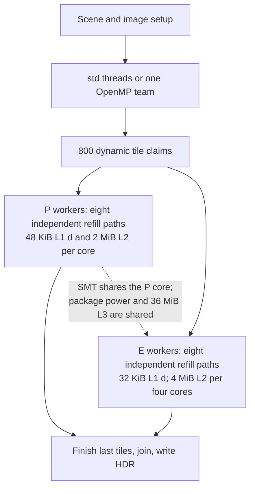

# OpenMP and core scaling

The refill kernel scales close to linearly within each core family. Eight P cores achieve **7.552×** speedup (**94.40%** of linear); sixteen E cores achieve **15.855×** (**99.09%**). OpenMP and `std::thread` are effectively tied: their median wall differences range from −0.17% to +0.52%, and all 15 configuration ranges overlap. There is no established runtime speedup.

A subsequent privileged pass obtained hardware counters without changing machine settings. [PERF.md](PERF.md) now records P/E cycle samples, topdown metrics, active/reference-cycle ratios, and memory-controller traffic. Lower active/reference ratios under package load support a frequency contribution to the scaling gap. Permission limits and hypotheses below describe the earlier unprivileged pass.

The workload is 320×320/128 spp, 13,107,200 completed paths, with identical PCG streams and path termination. Every one of the 150 scored runs executes exactly 88,965,817 live ray segments and 89,020,640 slots. The same binary contains both runtime choices; GCC 15.2 uses `-O3 -march=native -ffp-contract=fast -std=c++17 -pthread -fopenmp`. Each configuration receives one complete warmup and five interleaved measurements. The supplemental E/SMT sweep is recorded separately. Primary time includes process startup, preparation, the entire render, HDR writing and teardown; internal render times are also saved. Ranges are observed spread, not confidence intervals.



Dashed lines on the left and center are the homogeneous linear ideal. Black marks on the right are estimates from isolated core/sibling-pair rates, assuming those rates remain unchanged under package load. They are neither guaranteed hardware upper bounds nor a measured serial fraction. Individual medians/ranges are in the committed JSON files.

## Measured configurations

| CPUs | std wall median | OpenMP wall median | std Mpaths/s | std speedup |
| --- | ---: | ---: | ---: | ---: |
| 1 P | 3.8600 s | 3.8680 s | 3.40 | 1.00× |
| 2 P | 1.9726 s | 1.9828 s | 6.64 | 1.96× |
| 4 P | 1.0174 s | 1.0174 s | 12.88 | 3.79× |
| 8 P | 0.5111 s | 0.5117 s | 25.64 | 7.55× |
| 1 E | 11.0779 s | 11.1201 s | 1.18 | 1.00× |
| 2 E | 5.5328 s | 5.5354 s | 2.37 | 2.00× |
| 4 E | 2.7709 s | 2.7726 s | 4.73 | 4.00× |
| 8 E | 1.3885 s | 1.3891 s | 9.44 | 7.98× |
| 16 E | 0.6987 s | 0.6987 s | 18.76 | 15.86× |
| 1 P, 2 SMT threads | 2.9470 s | 2.9458 s | 4.45 | 1.31× |
| 8 P, 16 SMT threads | 0.3907 s | 0.3901 s | 33.54 | 9.88× |
| 8 P + 4 E | 0.4406 s | 0.4405 s | 29.75 | 8.76× |
| 8 P + 8 E | 0.3987 s | 0.3985 s | 32.88 | 9.68× |
| 8 P + 16 E | 0.3315 s | 0.3310 s | 39.54 | 11.65× |
| 8 P with SMT + 16 E | 0.2855 s | 0.2862 s | 45.91 | 13.52× |


E-only speedups use the one-E baseline; every other speedup uses one P. One E core supplies about **34.8%** of one favored P core's rate for this kernel. Therefore 24 physical cores should not be expected to deliver 24× one-P performance. The largest completed-path rate is **45.91 million/s**, using all 32 logical CPUs. CPU 8 is the one-P baseline; nested P subsets are 8;8,10;6,8,10,12; then 0,2,4,6,8,10,12,14. E cores use 16–31. The measured data retains exact mappings.

## What is linear on a hybrid CPU

For equal cores at unchanged effective frequency, `S(n)=n` is the useful reference. We are close to it within both core types. Small E-core ratios above 100% arise from baseline/run variation and are not evidence of a new superlinear mechanism.

For P/E mixtures, calibrate rates from this exact kernel:

```
Rideal(physical) = P_count * R_one_P + E_count * R_one_E
Rideal(with SMT) = P_count * R_one_P_sibling_pair + E_count * R_one_E
```

This predicts **46.10 million paths/s** for 8 P +16 E, compared with 39.54 measured: **85.79% of calibrated wall-rate capacity**. Including both P siblings predicts 54.51 million/s for all 32 logical CPUs, compared with 45.91: **84.22%**. Render-only versions of those ratios are 86.54% and 85.24%; wall-rate ratios include per-process overhead. These are model-relative efficiencies, not hardware utilization.

SMT gives about **30.8%** additional throughput on the eight P cores and **16.1%** when added to the 24 physical cores. A sibling shares execution units and caches with its physical core; it is not another equal core.

The capacity model assumes independent isolated-core rates. Package power/frequency, favored-core differences, shared resources and changed work distribution can reduce aggregate throughput. Comparing 24 physical throughput with the sum of separately measured 8-P and 16-E group rates gives 89.1% instead. Neither comparison proves which resource causes the remaining gap. In particular, this data does not justify fitting a global serial fraction from a heterogeneous core count.

## What OpenMP changes

Both runtimes call the same worker function and use the same relaxed atomic tile queue. OpenMP uses one team for the image:

```cpp
omp_set_dynamic(0);
#pragma omp parallel num_threads(options.threads)
{
    worker(omp_get_thread_num());
}
```

The implementation also checks the actual team size and applies identical CPU affinity. `std::thread` explicitly creates and joins the workers. The hot intersection, refill, scratch ownership and ordered pixel sums are unchanged. OpenMP expresses team creation with one directive and adds a runtime/build dependency. It does not improve arithmetic capacity in these measurements. This is a controlled team-runtime comparison; it does not compare OpenMP's built-in `for` scheduler against the shared queue.

A worker claims a 16×8 tile and owns its pixels. At 320 width there are 800 tiles, so 32 workers average 25 tile claims each. A frame creates a team once, not once per bounce or ray. The code already avoids shared RNG mutation and per-sample atomic additions. GNU's runtime behavior is documented in the [libgomp manual](https://gcc.gnu.org/onlinedocs/libgomp/); the API calls are checked against [OpenMP's published interfaces](https://github.com/openmp/sources/blob/main/_autodocs/api-reference/omp.h-execution-environment.md).

## Perf and worker evidence

`perf stat -e duration_time,user_time,system_time` succeeds. These pseudoevents report elapsed and aggregate user/system CPU time; they do not measure cycles, instructions or cache behavior. Hardware events and software `task-clock`/context-switch events are denied at the current `perf_event_paranoid=4`. No policy or power setting was changed.

Separate diagnostics collect tile/ray counts, entry/finish timestamps, thread CPU time and exit CPU. All six diagnostic runs reconcile exactly 800 tiles,13,107,200 paths and 88,965,817 rays. Every exit CPU matches the requested affinity. In the mixed 24 run, P workers claim 451 tiles and E workers 349; dynamic claims adapt to different throughput rather than imposing an equal tile count.

| Diagnostic | Elapsed | User CPU time | System CPU time | Finish spread |
| --- | ---: | ---: | ---: | ---: |
| 1 P-std | 3.8887 s | 3.8863 s | 0.0020 s | 0.00 ms |
| 8 P-std | 0.5120 s | 4.0616 s | 0.0040 s | 0.77 ms |
| 16 E-std | 0.7029 s | 11.1431 s | 0.0070 s | 3.72 ms |
| 24 physical-std | 0.3268 s | 7.6512 s | 0.0080 s | 4.78 ms |
| 32 logical-std | 0.2829 s | 8.7151 s | 0.0100 s | 6.57 ms |
| 32 logical-omp | 0.2818 s | 8.7609 s | 0.0050 s | 3.98 ms |


Worker CPU-time divided by the sum of each worker's entry-to-finish interval is about 99.7% for 24 physical and 99.5% for 32 logical CPUs. That is **scheduled CPU occupancy**, not instruction-unit utilization: a busy thread can still stall on division, loads, dependencies or branch recovery. Worker finish spread is only 4.78 ms in the mixed 24 run and 6.57 ms in the 32-thread std run; launch spread is 6.13 and 6.47 ms respectively. The observed tail is too small to explain the entire calibrated-capacity gap by itself.

Entry timestamps precede affinity/scratch setup; CPU is sampled only at exit. Diagnostic rendering times also include report serialization, so none of these timings replace the uninstrumented benchmark medians. Aggregate process CPU time can exceed elapsed time because threads run concurrently. Perf's timing data agrees with substantial parallel execution but supplies no IPC, cache-miss or stall percentages.



The per-tile ordered result buffer is 192 KiB at 128 spp. Hot geometry/path state is small, but the result buffer exceeds L1 and belongs in the L2 analysis. Geometry fitting in L1 does not prove a measured hit rate. The live driver is active `intel_pstate` with `powersave`/`balance_performance`; that is dynamic frequency selection, not proof of a fixed low clock. No throttling is measured.

## Validation and next experiments

96 strict raw-image checks cover scalar/flat/ray kernels, batches 1/2/4/8, AoS/SoA, fixed/refill groups and both runtimes, including sample/tile tails. Two further full 320²/128-spp float32 comparisons are bit-identical across std/OpenMP: one with contraction permitted, one with contraction off. The team-size guard rejects a request that `OMP_THREAD_LIMIT` prevents. ASan/UBSan pass on the shared driver with OpenMP refill and std flat rendering; the numerical intersection suite also passes.

The current queue and tile size are supported by the measured balance. Practical follow-ups, ordered by what they would answer:

1. Sample sustained frequency/package-power telemetry while running 8 P,16 E and mixed cores. This tests why calibrated rates change under aggregate load; it does not require replacing the kernel.
2. Compare worker-private reuse of the 192-KiB result allocation against the current per-tile allocation. This isolates setup/storage cost. An ordered completion ring is a more complex later variant.
3. If hardware counters become available, profile P/E PMUs separately and attribute cycles to intersection, sampling and storage before changing instruction scheduling further. A direct SoA ray interface could remove adapter copies, but its gain is not established.

These are unmeasured follow-ups. The work already completed shows nearly linear homogeneous scaling and no meaningful std/OpenMP runtime difference.

## Reproduce

```sh
make simple advanced
./build/pathtracer_simple 128 320 build/omp.hdr --kernel rays --batch 8 --refill --threads 32 --runtime omp
make test-compute
python3 benchmark_compute.py --matrix benchmarks/compute-configs/openmp.json --output build/openmp.json
python3 benchmark_compute.py --matrix benchmarks/compute-configs/openmp-extra.json --output build/openmp-extra.json
# Separate diagnostics; do not include them in primary benchmark timing:
perf stat -e duration_time,user_time,system_time -- ./build/pathtracer_simple 128 320 build/profile.hdr --kernel rays --batch 8 --refill --threads 32
./build/pathtracer_simple 128 320 build/diagnostic.hdr --kernel rays --batch 8 --refill --threads 32 --runtime omp --worker-report build/workers.json
```

The committed matrices provide one CPU per worker via `--cpus`. Default runtime is std; select omp explicitly. `OMP_FLAGS` defaults to `-fopenmp`; set it empty to build the std-only implementation where OpenMP is unavailable. `benchmarks/plot_scaling.py` reproduces the figure with matplotlib. Raw rows and diagnostic counts are in `benchmarks/computation-openmp*.json` and`computation-worker-diagnostics.json`. The earlier six-proposal measurements correspond to commit`c10b7a2` and are discussed separately in [COMPUTATION.md](COMPUTATION.md).
