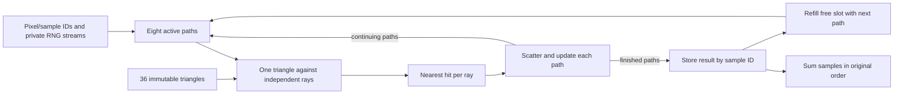

# More talks, applied to this computation

Subagents reviewed relevant transcript passages from eight additional Matt Godbolt talks/episodes and four related CppCon talks. Astra at xhigh audited the hardware-counter interpretation. The conclusion is to retain the ordinary C++ refill design and optimize its hot interfaces and generated schedule. AoS/SoA, branchless code, and fewer instructions are tools to test, not goals by themselves.

The detailed reviews are [Godbolt](benchmarks/reviews/godbolt-talks.md), [Pikus/Carruth/Amstutz](benchmarks/reviews/other-performance-talks.md), and [the perf audit](benchmarks/reviews/perf-results-audit.md). They identify actual caption passages, source quality, and primary links. This was focused transcript reading, not a claim to have watched every minute. Automatic captions were cross-checked against original slides/articles where available; Carruth's 2015 caption track has timing errors, so no precise timestamp is claimed for it.

## The most relevant talks

| Speaker / talk | Useful passage | Connection to tiny-pathtracer |
| --- | --- | --- |
| Godbolt, **Path Tracing Three Ways**, CppCon 2019 | [40:31](https://www.youtube.com/watch?v=HG6c4Kwbv4I&t=2431), performance investigation; [46:54](https://www.youtube.com/watch?v=HG6c4Kwbv4I&t=2814), combined rejection predicates | His renderer's branch rewrite helped one data-oriented implementation and hurt another. Our affine/culling kernels also show that fewer instructions do not ensure less time. |
| Godbolt, **What Has My Compiler Done for Me Lately?**, 2017 | [06:41](https://www.youtube.com/watch?v=bSkpMdDe4g4&t=401), measurement; [speaker notes](https://mattgodbolt.github.io/ce-cppcon-talk/) | Inspect generated instructions and measure the whole renderer. Handwriting more elaborate source can be undone or outperformed by compiler recognition. |
| Godbolt, **SIMD City**, AoCO 2025 Day 20 | [07:04](https://www.youtube.com/watch?v=d68x8TF7XJs&t=424), updates; [article](https://xania.org/202512/20-simd-city) | Contiguous independent elements allow packed arithmetic. Alias checks and conditional updates can change the generated loop. |
| Godbolt, **When SIMD Fails**, Day 21 | [04:38](https://www.youtube.com/watch?v=lUTvi_96-D8&t=278); [article](https://xania.org/202512/21-vectorising-floats) | Float reductions have serial rounding semantics. Independent rays can vectorize while we retain ordered pixel accumulation. |
| Godbolt, **Aliasing**, Day 15 | [03:01](https://www.youtube.com/watch?v=PPJtJzT2U04&t=181); [article](https://xania.org/202512/15-aliasing-in-general) | Valid non-overlap contracts can remove repeated loads/stores. They must reflect actual ownership. |
| Godbolt, **Loop-Invariant Code Motion**, Days 13/14 | [Day 13 02:19](https://www.youtube.com/watch?v=dIwaqJG0WDo&t=139), [Day 14 03:31](https://www.youtube.com/watch?v=OwFNblEEAXo&t=211) | An instrumentation store can obstruct hoisting. Keep work-count diagnostics separate from scored builds. |
| Godbolt, **Inlining**, Day 17 | [03:03](https://www.youtube.com/watch?v=JFHfFTvMPp0&t=183); [article](https://xania.org/202512/17-inlining-the-ultimate-optimisation) | Specialization can simplify a loop; forcing all helpers inline can grow code and increase register pressure. |
| Fedor Pikus, **Branchless Programming in C++**, 2021 | [08:57](https://www.youtube.com/watch?v=g-WPhYREFjk&t=537), dependencies; [40:00](https://www.youtube.com/watch?v=g-WPhYREFjk&t=2400), short-circuit conditions; [55:04](https://www.youtube.com/watch?v=g-WPhYREFjk&t=3304), predictable branch example | Independent work can overlap. Removing a branch may add arithmetic, and predictable rejection may be beneficial. |
| Chandler Carruth, **Tuning C++**, 2015 | [Recording](https://www.youtube.com/watch?v=nXaxk27zwlk), benchmark/profiler demonstrations | Ensure the benchmark still computes useful output; inspect neighboring instructions around samples rather than assigning every sample to its displayed instruction. |
| Carruth, **Hybrid Data Structures**, 2016 | [17:17](https://www.youtube.com/watch?v=vElZc6zSIXM&t=1037), traversal; [42:07](https://www.youtube.com/watch?v=vElZc6zSIXM&t=2527), separating fields | Choose representation for the fields an operation consumes. A small regular triangle scan and compact path state can suit different layouts. |
| Jefferson Amstutz, **Compute More in Less Time Using C++ SIMD Wrapper Libraries**, 2018 | [40:16](https://www.youtube.com/watch?v=8khWb-Bhhvs&t=2416), layouts; [47:03](https://www.youtube.com/watch?v=8khWb-Bhhvs&t=2823), independent rays; [56:07](https://www.youtube.com/watch?v=8khWb-Bhhvs&t=3367), partial lanes | Vectorize independent items; masked-out outputs do not necessarily save vector arithmetic. Vector trigonometry may use different algorithms. |

Godbolt's 2019 branch results were single-threaded GCC 9.2 on an i9-9980XE, not this hybrid CPU. His component-SoA/SIMD discussion was future work, not a measured SIMD result. The historical talks explain mechanisms; [our perf measurements](PERF.md) establish this machine's observations.

## What is actually being computed?

Each path repeats a dependent sequence: find its closest triangle, use that hit to sample a new direction and update weight, then trace the new ray. Bounce N+1 cannot start before bounce N supplies its ray. Different paths are independent.

The eight slots are a small pool of independent computations. Their array indices are called lanes because the compiler maps eight float operations to AVX2. The source does not need vector types or a packet class. A simple loop over active paths exposes the independence; refill prevents terminated paths from leaving unused slots. The geometry is reused across those paths. Each core runs its own pool and takes another tile when ready.

This is why globally converting everything to SoA is not the objective. Intersection wants origin/direction columns; scalar scatter wants most fields of one path. The current adapter copies ray data into columns. We should test that boundary directly rather than infer its cost from layout names.

## What the new measurements add

- On one P core, ordinary refill uses about 1,758 cycles and 4,480 retired instructions per completed path; scalar uses 5,981 and 10,983. Fixed eight-path groups have higher IPC but waste more work per completed path.
- P topdown bad-speculation slots fall from 42.8% scalar to 22.0% refill. This is supporting evidence for more regular execution, not a claim that all saved time came from branch prediction.
- Inclusive cycle samples put intersection near 47% on P and 68% on E. P scatter and sampling now deserve attention alongside intersection. Parent/child percentages overlap.
- Memory-controller traffic is about 150–173 MiB/s during ten-render windows, including background work. Geometry reuse makes DRAM bytes much smaller than the loads executed inside L1. Cache traffic and register pressure remain possible costs.
- P active/reference cycles decline with package load while cycles per completed path stay nearly constant in P1/P8. Isolated-core rates are therefore an imperfect linear ideal for mixed load. OpenMP is tied with std::thread; neither removes these hardware effects.

## Three proposals that preserve simple code

| Proposal | Smallest useful change | Evidence to seek |
| --- | --- | --- |
| **1. Direct hot ray columns** | Keep AoS path bookkeeping; give intersection origin/direction columns directly and retain its ordinary C++ nested loop. | Fewer adapter copies/reloads or spills, unchanged matched-reference output, and better full-render throughput. Global path SoA was slower through the old adapter, so this is a separate question. |
| **2. Reuse worker storage** | Allocate the ordered tile-result buffer once per worker; test initialization and a few tile sizes separately. | Less allocation/zeroing or cache traffic while retaining sample-ID indexing and sum order. The profile has not established allocation as a major cost. |
| **3. Compiler feedback, then sampler algebra** | Try GCC PGO on unchanged source. If the profile still points to scatter, batch its independent vector/weight algebra while retaining scalar trigonometry and PCG draws. | Better generated schedule and total throughput without changing numerical semantics. Treat PGO and sampler changes as separate experiments. |

The first and third target visible costs; the second is a small reuse experiment whose ceiling may be modest. PGO is an additional project proposal supported by [GCC's documentation](https://gcc.gnu.org/onlinedocs/gcc/Optimize-Options.html#index-fprofile-use), not a measured improvement established by these talks.

## Three proposals with more optimization freedom

| Proposal | Approach | Tradeoff and validation |
| --- | --- | --- |
| **4. Two independent eight-ray blocks** | Offer the compiler two blocks of independent intersection work to interleave long dependency chains. Start with ordinary C++; use intrinsics only if code generation requires them. | More live registers can increase spills and code size. Preserve each ray's operation order and test actual assembly, P/E throughput, and tails. Divider activity alone does not justify this. |
| **5. A vectorized scatter/sampler stage** | Batch RNG, normalization, and direction math; consider a vector math library as a separately classified numerical variant. | Current scalar sine/cosine semantics may differ from vector algorithms. First preserve draw identity and scalar transcendental results; report error and hit changes separately for relaxed variants. |
| **6. Separate control-flow and arithmetic scheduling** | Compare staged/combined rejection crossed with early/late division. Then test cheap whole-group rejection or culling only where it saves enough work. | A four-way comparison can isolate effects currently changed together. Check representative fixed rays and whole renders. Fewer candidates, divisions, or branches are insufficient success criteria. |

Every experiment should keep the estimator, scene, per-path RNG identity, termination, tie ordering, and final sample order fixed within its declared floating-point configuration. Rank completed paths/s using whole-executable time; retain source hashes, emitted code, counters, and P/E/SMT scaling. Amdahl's limit matters: accelerating intersection alone leaves scatter and the rest of the renderer. These proposals are hypotheses, not claimed additional speedups.
