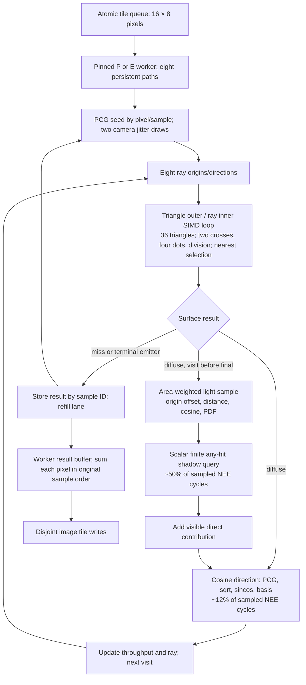

# Astra general renderer and CPU analysis, pass five

The user's correction is incorporated: this is a general rendering analysis, not an STL-removal argument. The priority is lower full-image error per second, followed by faster execution of the same estimator. A plain implementation is a useful controlled baseline; library removal by itself is not a demonstrated optimization.

## Scope and current evidence

Read-only review on 2026-10-14: a fresh cable SSH connection found repository HEAD `ddf6d6cf081d943bccadf283d84dcfe0cbfa5836`. The current `experiments/render_driver.h`, `experiments/simple_kernels.h`, `experiments/quality_sampling.h` and quality entrypoint match the audited round-four local snapshots. The only untracked source then was the parent's in-progress `experiments/pathtracer_plain.cpp`. No remote source, settings or benchmarks were changed by this analysis.

The decisive observations are:

- The final 128×128, 128-spp, eight-seed comparison gives **10.344× better full-image efficiency for NEE than uniform**, using the ratio of mean per-run MSE×process-wall-time products. NEE costs more per path but needs far fewer paths for the same measured error. NEE and MIS have almost identical error here; retain the simpler NEE default.
- About **87% of NEE's remaining full-image squared error lies in 106 pixels** excluded by the `max(reference RGB)<2` mask. This is a brightness-defined subset, not a proven edge classification. Primary visible-emitter coverage is a plausible explanation to test with an error map and primary-hit mask. The 78.144× masked efficiency number is secondary, not the full-image headline.
- The latest NEE P-core profile attributes about **50.36% inclusively to finite shadow visibility**, **20.16% to continuation-ray batch intersection**, and **11.60% to cosine-direction generation**. Scatter's 72.60% includes visibility and cosine generation: these shares overlap and must not all be added. This was one roughly 2,000-sample, 499-Hz cycle profile with no lost samples and parent-verified production/debug text identity. It is approximate stage composition, not exact removable time.
- The nearest-hit numerator experiment reduced divider-active count by **58.86%**, yet P cycles/path increased from about **1518.14 to 1540.65**. Its tiny instruction reduction did not buy throughput. Divider activity is not a removable stall fraction. Additional dependencies, selection and scheduling are hypotheses, not an isolated diagnosis.
- xoroshiro128++ won the 40-draw synthetic test but established no integrated renderer gain. Seeding and short paths matter; retain PCG and its deterministic pixel/sample identity. Do not trade a tested sampler for a smaller instruction count without an image-quality and full-render result.
- Earlier ordinary C++ ray SIMD plus persistent refill beat explicit AVX2 alternatives. Fixed groups wasted many slots; refill largely solved that. Direct-column transport did not establish a gain. These negative controls argue against repeating source-layout changes without a specific new bottleneck.

The quality reference is the mean of 24 independent 2048-spp images, 49,152 spp total. Its estimated noise MSE is 4.674e-7. Agreement checks support the intended common finite-depth target, but do not prove unbiasedness; retain the reported uniform mean-brightness difference of 2.311 estimated standard errors. See `quality-final/analysis.json`, `quality-final/metadata.json`, `perf/counts.json`, `perf/sampling-nee-inclusive.txt`, `rng/analysis.json` and `final-audit.md` for provenance. Quality-final predates optional RNG source additions; subsequent PCG uniform/cosine/NEE image hashes matched, while timings belong to their own binaries.

## Current computation and data flow

The diagram's direct-light branch only operates for diffuse visits 0–22. Visit 23 may still collect emission, but must not add a light connection consuming a 25th surface visit. The current implementation unnecessarily samples a continuation at the final diffuse visit; a small separately measured dead-work deletion can stop after retaining the current result. Skipping those unused random draws preserves rendered output, not an assertion that every internal RNG state remains unchanged.

The i9-14900K was freshly verified as 8 P cores with SMT plus 16 E cores, 32 logical CPUs. Sysfs reports P L1d 48 KiB and L2 2 MiB shared by its SMT siblings; E L1d 32 KiB and L2 4 MiB shared by each four-core cluster; shared L3 is 36 MiB. AVX2 and FMA are available, AVX-512 is not exposed. CPU8/9 are one P core's siblings; CPU16–19 share an E-cluster L2.

The 36 AoS triangles occupy 2592 useful bytes; p/e1/e2 alone are 1296 bytes. This compact geometry can be reused from cache and broadcast over eight rays. It is not the renderer's entire working set: each full-tile result buffer is 192 KiB at 128 spp or 768 KiB at 512 spp, plus paths, image, code and sampler state. At 512 spp, four E-worker result buffers occupy 3 MiB of their shared 4-MiB L2 before other data. These are footprint calculations, not measured residency. L1 loads/stores, register spills, useful unique bytes and DRAM bytes are different quantities. Earlier low retired demand-load miss counts and system-wide controller traffic make a DRAM-bandwidth-first diagnosis unpersuasive; they do not prove every access hits L1.

Keep useful output as the objective: lower MSE×seconds, or fewer cycles for an identical result. Maximizing nominal FLOPs per byte can make the renderer worse by retaining avoidable intersections or expensive random samples.

## Three simple proposals, in priority order

### S1 — Stratify camera jitter, keeping the current camera integral

For a known sample budget N, choose integers nx×ny=N, preferably near square. Assign each sample ID one stratum and replace the two camera uniforms by `(sx+u)/nx, (sy+v)/ny`. Preserve the existing subsequent **0.5 multiplier** and pixel transform: the current camera samples only its existing half-pixel domain. Widening that domain would change the target and invalidate a comparison to the existing reference. For arbitrary prime budgets, a 1×N fallback is correct but less balanced; do not silently round N upward.

This consumes the same two PCG draws as before and adds only camera setup arithmetic once per path. It changes rays and image bits. First stratify camera dimensions only: do not reuse the same unpermuted stratum indices for light and BSDF dimensions, which can introduce unwanted correlations. Keep ordinary random continuation and NEE samples as the control. Clamping a rounded endpoint below one is reasonable but must be explicit and tested, not an unnoticed camera change.

**Falsifiable test:** use the existing 32/128/512-spp budgets, eight independent seeds initially, unchanged finite-depth reference and full-image MSE×wall time. Report the bright subset separately, a primary-emitter mask, and per-pixel error maps. Check one sample per stratum, support, mean jitter and deterministic worker-count independence. Promote only if the full-image product improves reproducibly; if intervals overlap, gather more independent replicates. A useful acceptance target is at least a 10% product reduction across more than one budget; this is an engineering gate, not a predicted gain. Validate at a second camera angle before claiming general benefit.

This is the strongest first quality hypothesis because the remaining error is concentrated in a tiny bright subset and the added per-path work is small. It is not yet a measured improvement.

### S2 — Give shadows a dedicated bounded any-hit predicate

First remove repeated **static** decisions: precompute each light plane's eligible blocker IDs, using exactly the current sampled-emitter and coplanar-emissive exclusion rule. Preserve triangle order initially. The present loop recalculates emissive/normal/plane classification for every shadow ray even though scene geometry is fixed. This can be tested separately with strict image equality.

Then test a small scalar shadow predicate that computes the ordinary Möller numerators D,U,V,T but never normalizes t/u/v and never writes a nearest Hit. For the accepted positive determinant, test `D >= 1e-10`, `U >= 0`, `U <= D`, `V >= 0`, `U+V <= D`, `T > 1e-4*D`, `T < distance*D`. Preserve staged early exits and stop at the first blocker. Unlike the losing nearest-hit numerator kernel, this query does not carry best-determinant state or compare candidate ratios: it only answers a bounded Boolean question.

**Numerical boundary:** real-arithmetic equivalence does not imply float equivalence. Rounded edge/endpoint tests can change classification; huge coordinate products can overflow. Keep the full finite segment and exact emitter-seam exclusions. Do not restore the previously incorrect shortened shadow segment. Compare old/new predicates on recorded actual shadow rays, double-reference adversarial cases, near-emitter blockers, endpoints, parallel rays, both sides, edges, seams and zero directions. Log ambiguous boundary cases separately and use a narrow fallback only when a justified error bound is available.

**Falsifiable test:** score the static-list variant first, the predicate second, and their combination last. Measure full NEE P1/E1/all32 time, triangles tested per shadow query and branch/divider events, with instrumentation removed for timing. Keep numerical-change variants distinct from exact controls. Require reproducible end-to-end improvement and estimator-mean agreement; fewer divisions alone is insufficient. Given the profile, this is the strongest small CPU-computation experiment.

### S3 — Test a trig-free cosine continuation

A short rejection sampler can draw x,y uniformly in [-1,1), repeat while r²=x²+y² is at least one, then return local `(x,y,sqrt(1-r²))`, transformed by the existing precomputed basis. A uniform accepted disk projected onto the hemisphere has the same cosine solid-angle PDF; diffuse throughput remains `beta *= albedo`, and MIS still uses cos/pi. It removes the polar radius square root and sincos, exchanging them for rejection, two squares and more RNG draws.

In ideal continuous sampling, acceptance is pi/4 and the mean number of uniform draws is 8/pi, about 2.546 versus the current two. These are geometric expectations, not measured machine costs. The current scatter stage is scalar per lane, so start there; do not add a variable-length SIMD rejection queue in this simple experiment. A hard iteration cap or biased fallback would change the distribution and is unacceptable. This method is less suitable for later fixed-dimension low-discrepancy sampling; keep polar/concentric mapping available for that experiment.

**Falsifiable test:** check finite unit directions, nonnegative normal cosine, local means E[x]=E[y]=0, E[z]=2/3, E[z²]=1/2, azimuth/radial histograms and acceptance rate across seeds. Record draws and rejection counts, then compare replicated cosine/NEE/MIS image means and MSE×seconds. Expect different image bits and later RNG draws; preserve scheduler determinism per path. Reject if extra branches/seeding interactions erase the full-render gain. Removing only final-visit unused continuation is an independent exact-output control before changing the sampler. The roughly 11.6% sampled cosine share limits this opportunity; it is smaller than shadows.

## Three more aggressive proposals

### A1 — Batch finite shadow rays, with a small per-worker queue

After S2, split diffuse scatter into prepare-direct-sample, visibility, and finish-scatter. Pack up to eight eligible shadow rays with their finite limits, exclusions and contribution payloads. Traverse triangles outside the ray loop so the same geometry serves eight visibility predicates. Retire blocked lanes and skip work when all lanes are blocked. Start with the shadows generated by the current eight live paths; only add persistent queue refill if measured occupancy justifies it.

Keep each path's random draws in the original sequence and apply its direct contribution before its next continuation. Do not advance or reuse a lane while its shadow payload is pending; lane generation IDs or explicit completion are necessary. MIS previous PDFs and offset origins must remain associated with the correct path. Use the old predicate first to isolate scheduling, then test numerator arithmetic. Avoid moving whole Paths through a scene-wide wavefront: compact shadow records suffice.

**Test/gate:** exact strict images for the scheduling-only variant, then the S2 numerical tests for arithmetic changes. Measure live shadow lanes, triangles actually evaluated, compaction and payload bytes, and full P/E/mixed-core time. Scalar any-hit may win when most rays terminate after a few triangles, while masked SIMD wastes work on early-blocked lanes. Demand a clear full-render gain, e.g. at least 5% beyond run variation, before keeping the added queue machinery. This is the first aggressive CPU candidate, not a promised 8× speedup.

### A2 — Randomized low-discrepancy camera, light and BSDF dimensions

If S1 helps but plateaus, test a proper scrambled Sobol sampler with fixed semantic dimensions: camera 0–1, then separate light-choice, light-position and BSDF dimensions per depth. Scramble by pixel and replicate seed independently of sample index. Avoid dimension allocation based on worker order or whether a branch consumed a draw. Preserve PCG as the reference; use a fixed-cost polar/concentric cosine map for this test rather than S3's variable rejection consumption.

This attacks sample placement instead of RNG arithmetic rate. Begin with camera plus first-bounce light dimensions before implementing every path dimension. A real scrambling scheme and verified direction numbers matter; merely XORing arbitrary hashes into an improvised bit pattern is not a sufficient validation. Randomized replicates are needed to estimate uncertainty; samples within one low-discrepancy sequence are not independent replicates.

**Test/gate:** validate the sampler against a primary implementation, uniform marginals and low-dimensional coverage, then compare full-image MSE×seconds at all budgets and at a second view/scene. Recompute replicate-based uncertainty. Stop if generator cost outweighs variance reduction or if improvement exists only on the brightness mask. This is the highest-potential aggressive quality follow-up, with greater validation and code cost than S1.

### A3 — A shallow shadow-specific spatial accelerator

Only after counting actual shadow tests, try conservative bounds for the room and the two blocks, with ordinary triangle predicates inside accepted groups. Use a small flat array and fixed stack/order rather than a general allocation-heavy BVH. Start from the authored geometric groups, and preserve exact leaf predicates. Bound tests may reject only segments guaranteed not to hit any constituent triangle; zero direction components, near-grazing segments and outward rounding need care. Source geometry has five room quads, one emissive quad and two six-face blocks, so a small hierarchy is sufficient to test the idea.

This is not the earlier generic nearest-hit culling experiment rerun under a new name. The hypothesis is that **finite any-hit shadows with coherent light destinations** permit useful group rejection or earlier blockers. The earlier culled kernel's lower instructions but higher cycles makes this the lowest priority of the six. Geometric quad/box replacement with different intersection semantics is a separate experiment, not a drop-in proof of equivalence.

**Test/gate:** first require zero old-predicate visibility differences on actual and adversarial rays, including blockers next to the emitter. Measure bounding tests, surviving leaf tests, branch misses, instructions and end-to-end time. A reduction in triangle count is not enough; discard the hierarchy if traversal costs lose on this 36-triangle scene. Larger scenes may justify it even if Cornell does not, but report those as separate workloads.

## Compiler, cores and memory: controls across all six

Keep the existing eight-ray refill and ordered per-pixel sums unless a measured change beats them. All-core scheduling should remain a small dynamic tile queue with explicit affinity. Compare one P, one E, eight physical P, sixteen E, twenty-four physical and thirty-two logical workers. For homogeneous cores use T1/Tn versus n. For a P/E mixture, the ideal rate is NP×RP+NE×RE using calibrated same-kernel single-core rates; SMT siblings share a core and are not two independent P cores. The previous final-quality scaling was **MIS**, not NEE: about 93.1% P8 and 94.8% E16 of homogeneous linear scaling. Do not silently reuse those labels for a new sampler.

Remaining scaling loss may involve package-frequency reductions, work imbalance, startup, serial image work or shared resources. Previous reference-cycle ratios showed frequency reductions under wider core use, so 32× homogeneous ideal is inappropriate. Record the current kernel's worker finish times, CPU time, work counts and P/E cycles/ref-cycles before blaming bandwidth or synchronization. Tile changes trade queue overhead against the last few workers' tail; larger tiles also increase result-buffer footprint.

PGO already gave a useful uniform-render gain. Train each candidate separately with an equivalent workload and identify whether the experiment uses mode-specific training or one representative mixture. NEE has different hot code from uniform; do not reuse a stale profile or compare a well-trained baseline with an untrained candidate and call the difference architectural. Keep ordinary and PGO builds visible. Recheck assembly/vectorization after changes, but retain timings as the score. No blanket forced inlining or fast-math is justified by the current evidence.

Use explicit cpu_core/cpu_atom events and report running fractions; do not merge their IPCs as if the microarchitectures were identical. Cycles/path and instructions/path are useful only with the same estimator/work accounting. For quality changes, also report rays, shadow rays and actual triangle predicates: one completed path is not a constant amount of useful work. Hardware divider-active counts, retired L1 demand misses and generic cache misses have different meanings and none directly measures application DRAM bytes.

## Where the plain implementation fits

Freshly read GCC15 libstdc++ sources show `array::operator[]` returning the underlying array element and `vector::operator[]` returning `*(start+n)`; `size()` is a pointer difference. Release subscript assertions depend on build settings. Templates and `if constexpr` in this renderer select implementations at compile time; there is no virtual Scene dispatch. The NEE report's 1.86% attribution to **inlined** vector::size is not an out-of-line container-call cost. It can still flag a loop-bound computation worth checking in assembly.

Real differences to measure include one-time vector result initialization, allocator and first-touch placement, fixed-count scene specialization, code size/inlining, CLI/output/startup work, and changed alias information. The current result buffer is already reused per worker, not allocated per bounce or tile. C arrays and malloc will not inherently remove numerical arithmetic, cache traffic or dependent operations. A fixed 36-triangle loop may help independently of whether storage came from vector or malloc.

The fair comparison is plain OpenMP against current Quality **OpenMP**, same pinned CPUs, PCG, sampling mode, geometry, 24 visits, offsets/PDFs, camera expression and sum order. Use identical optimization and FP-contraction flags; separately train PGO if used. Keep worker allocation and output in equivalent timed regions and report both render-only and process-wall time. Strict raw-image parity across modes/seeds/schedules is the first acceptance test. Fast-build differences must be quantified rather than silently called equivalent. A winning plain executable is worth retaining; its cause should be explained by changed work or code generation, not attributed wholesale to “STL overhead.”

## Measurement decision and references

Build one isolated variant at a time from the frozen baseline. For exact transformations require strict image equality and matched work counts, then five warmed interleaved full-render observations per scored configuration. For changed sampling or predicates require numerical/unit checks, independent high-spp mean agreement, replicated MSE×process-wall-time and noise-floor disclosure. Report ratio of mean products consistently. Reference and pilot images must not be reused as scored random replicates. Do not combine two unproven changes and infer which one caused a gain.

Manuka §2.4 was reread directly from the preserved manuscript's page five. Its example is a **halving of sample standard deviation**, which gives a fourfold sample-count advantage and can tolerate fourfold sample cost at break-even. The relevant lesson is efficiency of the estimator. Its whole-path CPU / shade-before-hit choices address complex production shaders and large scenes; they are not evidence that our 36 triangles need that architecture.

Primary reading:
- [Manuka author manuscript, §2.4](https://jo.dreggn.org/home/2018_manuka.pdf), preserved locally as `references/2018_manuka.pdf`.
- [PBRT: stratified sampler](https://pbr-book.org/4ed/Sampling_and_Reconstruction/Stratified_Sampler), for randomized strata and independently associated dimensions.
- [PBRT: sampling multidimensional functions](https://pbr-book.org/4ed/Sampling_Algorithms/Sampling_Multidimensional_Functions), for disk projection and the cosine PDF. S3's rejection-cost calculation is this report's elementary area-ratio derivation.
- [PBRT: Sobol samplers](https://pbr-book.org/4ed/Sampling_and_Reconstruction/Sobol_Samplers), for verified low-discrepancy construction and randomization.
- [PBRT: bounding-volume hierarchies](https://pbr-book.org/4ed/Primitives_and_Intersection_Acceleration/Bounding_Volume_Hierarchies), for the traversal/build tradeoff; Cornell benefit remains a hypothesis.
- Installed primary implementation inspected over SSH: `/usr/include/c++/15/array` and `/usr/include/c++/15/bits/stl_vector.h`. Hardware topology came from current lscpu and `/sys/devices/system/cpu/cpu{8,16}/cache/index*`, not a guessed generic core model.
