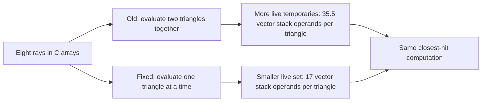

# Recovering the STL-free renderer's speed

**Follow-up:** [Round seven](ROUND7.md) compares Clang and isolates the original
vector loop's guard and header-copying behavior with both storage forms.

The initial plain renderer's slowdown came from generated code, not a need for
STL. Five ordinary `inline` declarations and one plain-target compiler option
recover the reference throughput while retaining C arrays, malloc/free, C I/O
and OpenMP. The sampling algorithm, PCG streams, arithmetic expressions,
geometry, 24-visit limit and ordered accumulation remain the same.

## What changed

GCC 15.2's O3 unroll-and-jam pass combined two triangle iterations in the plain
eight-ray intersection loop. This increased live temporary values and stack
operands. Disabling that pass restores the one-triangle loop while keeping
eight-wide AVX2 arithmetic. GCC documents the pass as outer-loop unrolling
followed by fusion of the resulting inner loops, and enables it at O3. [GCC 15.2 optimization options](https://gcc.gnu.org/onlinedocs/gcc-15.2.0/gcc/Optimize-Options.html)

The source marks `intersect_batch`, `visible`, `power_weight`,
`cosine_direction` and the `scatter` template inline. GCC integrates the hot
helpers into the worker in this build. This restores useful inlining boundaries;
the keyword is not a guarantee that every compiler will inline a function.
`PLAIN_FLAGS ?= -fno-loop-unroll-and-jam` applies only to the plain fast and
strict targets. It can be overridden for another compiler.

|Main intersection loop|Triangles/iteration|Static instructions/triangle|YMM stack operands/triangle|YMM divisions/triangle|
|---|---:|---:|---:|---:|
|Quality reference, inlined|1|83|17|1|
|Initial plain|2|89.5|35.5|1|
|Fixed plain, inlined|1|84|17|1|

These are static assembly counts in the main loop, including memory operands
on arithmetic instructions. They are not cache misses or DRAM bytes. Some
stack references access source arrays, others temporary values. The fixed loop
cuts the repeated stack-reference count by about 52%, not necessarily elapsed
time by that amount. The out-of-line no-jam helper's stack frame also shrinks
from 1088 to 576 bytes; worker frames contain additional scheduling state and
should not be compared as if they were intersection-only frames.

## Full-render comparison

|Sampling / CPUs|STL reference s|Initial plain s|Fixed plain s|Fixed vs reference|
|---|---:|---:|---:|---:|
|uniform / P1|3.602154|3.909628|3.611638|+0.26%|
|uniform / all32|0.273142|0.280206|0.274919|+0.65%|
|nee / P1|8.278475|8.827504|8.174291|-1.26%|
|nee / all32|0.561486|0.578039|0.550217|-2.01%|

Uniform timing ranges overlap with the reference. NEE fixed/reference ranges
do not overlap in either CPU scope in this run. Full observed ranges are saved
in `benchmarks/round6/summary.json`; the small NEE improvement is specific to this configuration.

All three versions use ordinary GCC 15.2 O3/native builds with FP contraction,
PCG 42, OpenMP, eight-ray AoS refill, 320×320 pixels and 128 samples per pixel.
P1 uses CPU8; all 32 uses explicit CPUs 0..31. Each combination has one warmup
and five scored interleaved observations with shuffled version order. Times
include startup, preparation, rendering, raw image output and teardown; hashing
is outside the timed region. Baselines are frozen binaries from commit 7659a28;
the fixed binary is the actual production target, not just a staged variant.
These are shared-workstation observations, not confidence intervals.

## Perf and correctness

|Mode/version|Cycles/path|Instructions/path|IPC|Loads/path|Stores/path|Active/reference cycles|
|---|---:|---:|---:|---:|---:|---:|
|uniform/stl|1631.2|4387.6|2.690|1461.4|447.6|1.8641|
|uniform/plain-old|1780.3|4632.0|2.602|1651.9|657.5|1.8655|
|uniform/plain-fixed|1631.9|4384.5|2.687|1423.6|441.6|1.8708|
|nee/stl|3771.4|10741.5|2.848|3566.2|650.8|1.8703|
|nee/plain-old|4017.3|10824.8|2.695|3448.0|773.6|1.8753|
|nee/plain-fixed|3707.7|10349.9|2.791|3277.3|442.5|1.8685|

Compared with the initial plain version, cycles/path fall 8.33% for uniform and
7.71% for NEE. Retired stores/path fall 32.84% and 42.81%; retired loads/path
fall 13.82% and 4.95%. Uniform cycles/path now match the reference to 0.04% in
these observations. Active/reference-cycle ratios differ by less than 0.4%
between old and fixed versions, supporting an execution-cost explanation.
All recorded hardware running fractions are 99–100%. These matched counters
support reduced instruction/temporary traffic; they do not identify a measured
cache-stall or DRAM-bandwidth limit.

Perf is a separate diagnostic run, after the unprofiled throughput comparison.
Two interleaved observations per version and mode use CPU8 and explicit
`cpu_core` user events. Root perf launches the renderer as user blacknoir.
Counts include process startup and raw output. Loads/stores are retired
instructions, not bytes moved to DRAM or cache misses.

All 62 strict comparisons passed for **pixels and work counts**: all four
samplers; widths 1/9/17/32/64 with sample/tile tails; 1/4/32 workers; and full
320×320/128-spp uniform and NEE renders. The full fast fixed images are
**bit-identical to the initial plain renderer** for uniform and NEE. Their
existing tiny differences from the fast STL reference are unchanged: uniform
RMSE 1.13e-9 / max 5.96e-8; NEE RMSE 2.95e-8 / max 1.62e-5. Strict images are exactly
identical to the reference. Fast NEE work differs from the reference by five
rays and five shadow rays out of 83M/50M, also unchanged from round five.

Dynamic dependencies remain libc, libm and libgomp, with no libstdc++ runtime
dependency. No allocator, ownership, sampling or accumulation logic changed.

## Controls and evidence

The focused 160×160 screen tested inline batch only, inline hot helpers,
original zeroing constructors, an unroll1 pragma, a count parameter, global
no-jam and a scoped no-jam attribute. Ordinary loop hints and the count
parameter retained two-triangle processing. Inline alone reduced stack
operands but did not eliminate it. Only the targeted compiler-pass switch
restored one-triangle processing; combining it with inline declarations
recovered the full small-screen gap.

The out-of-line global no-jam and function-scoped no-jam controls have
byte-identical text. The inline-batch and inline-batch/unroll1 controls also
have byte-identical text. Timing differences within those pairs cannot be
credited to different executable instructions. The production winner has
identical normalized disassembly, including instruction addresses, to the
staged winner; source/include paths change RIP-relative string/data addresses,
so their text sections are not claimed byte-identical.

[Astra's xhigh compiler audit](../../../benchmarks/round6/astra-compiler-audit.md)
contains addresses, static counts, call boundaries and exact identities.
The short-screen and full-render records, source/command hashes, numerical
checks and perf exports are in `benchmarks/round6/`. Probe binaries and raw
images remain in ignored `build/pass6/`.

The result establishes that this renderer can keep its speed without STL.
It does not establish an inherent performance advantage for either storage
style, or that disabling unroll-and-jam is always beneficial. Recheck the loop
and timings when changing the compiler, scene or batch width.
